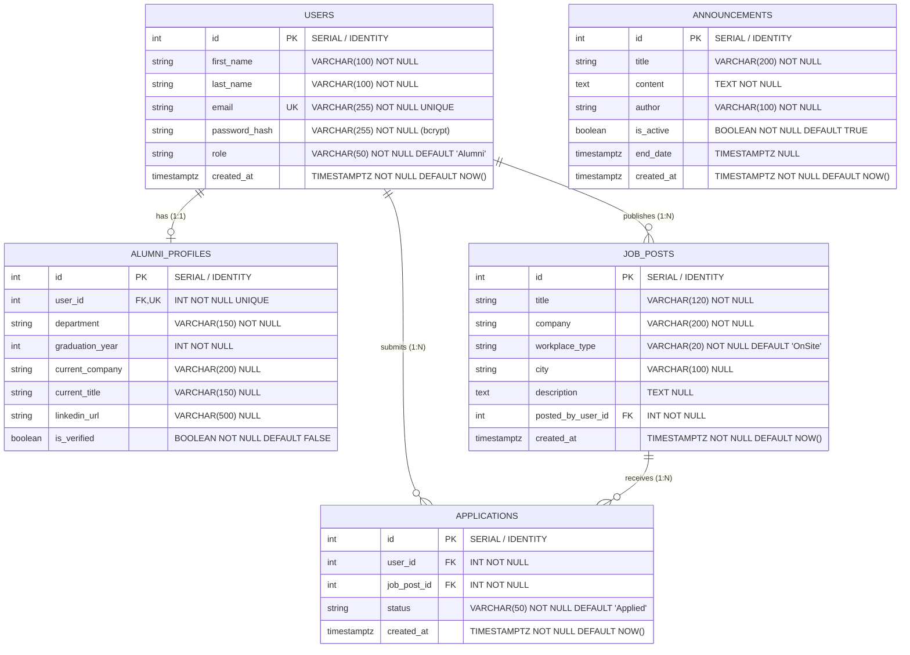

# 📊 Alumni Tracking System — Data Design & Database Architecture

> **Doküman Türü:** Veri Modeli ve Veritabanı Mimari Şartnamesi (Data Design Specification / ddd.md)  
> **Teknoloji Yığını:** PostgreSQL 16 (`docker-compose` persistent volume: `postgres_data`) & Entity Framework Core (EF Core)  
> **Sürüm:** v1.4 (9. Hafta: Kullanıcı Rolleri, Yetki Matrisi (RBAC / Who May Do What), Kimlik Doğrulama ve Sahiplik Kuralları)  
> **Durum:** Aktif / Single Source of Truth (SSOT)

---

## 1. 🎯 Genel Bakış ve Mimari Altyapı

Bu doküman, **Alumni Tracking System (Mezun Takip Sistemi)** projesinin ilişkisel veritabanı şemasını, varlık (entity) modellerini, ilişkilerini (cardinality), kısıtlamalarını (constraints), silme davranışlarını (delete behaviors) ve iç içe uç nokta (nested routing) sözleşmelerini tanımlayan **tek ve bağlayıcı kaynak (Single Source of Truth)** niteliğindedir.

### 1.1 Teknoloji ve Altyapı Standartları
* **Veritabanı Motoru:** **PostgreSQL 16** (`postgres:16-alpine` resmi Docker imajı).
* **Konteyner ve Kalıcılık:** `docker-compose.yml` içerisinde `alumni-db` servisi altında `postgres_data` adlandırılmış volume (named volume) ile `/var/lib/postgresql/data` dizininde tam veri kalıcılığı.
* **ORM (Object-Relational Mapping):** **Entity Framework Core (EF Core)** - Code-First yaklaşımı.
* **Sürücü / Sağlayıcı:** `Npgsql.EntityFrameworkCore.PostgreSQL`.
* **İsimlendirme Konvansiyonu:**
  * **C# / EF Core Katmanı:** `PascalCase` (Örn: `AlumniProfile`, `JobPost`, `Application`, `PostedByUserId`).
  * **PostgreSQL Veritabanı Katmanı:** `snake_case` (Örn: `alumni_profiles`, `job_posts`, `applications`, `posted_by_user_id`).
  * **Tablo İsimleri:** Çoğul (Plural) form (`users`, `alumni_profiles`, `job_posts`, `applications`, `announcements`).

---

## 2. 🧩 Varlık-İlişki Diyagramı (Entity-Relationship Diagram - ERD)

Aşağıdaki Mermaid ER şeması sistemin temel varlıklarını, birincil (PK) ve yabancı (FK) anahtarlarını, veri tiplerini, 1:1, 1:N ve M:N (Join Table üzerinden) kardinalitelerini göstermektedir:



> **Not:** `USERS` ve `JOB_POSTS` arasındaki çoka-çok (**Many-to-Many**) ilişki, bir ara tablo (Join Table) olan `APPLICATIONS` tablosu üzerinden kurulur. Bir satır tam olarak bir `(user_id, job_post_id)` çiftini temsil eder.

---

## 3. 📋 Varlık Modelleri ve Nitelikler (Entities & Attributes)

### 3.1 `Users` Tablosu (`users`)
Platforma kaydolan tüm kullanıcıların (Mezun / `Alumni` ve Yönetici / `Admin`) kimlik, şifre özeti (hash) ve rol bilgilerini tutar. Oturum açmamış ziyaretçiler (`Guest`) bu tabloda yer almaz.

| Sütun Adı (DB) | C# Özellik Adı | Veri Tipi (PostgreSQL) | C# Tipi | Boş Olabilir? | Kısıt / İndeks | Açıklama |
| :--- | :--- | :--- | :--- | :--- | :--- | :--- |
| `id` | `Id` | `SERIAL` / `INTEGER` | `int` | **Hayır (PK)** | `PRIMARY KEY` | Benzersiz kullanıcı tanımlayıcısı |
| `first_name` | `FirstName` | `VARCHAR(100)` | `string` | **Hayır** | `NOT NULL` | Kullanıcının adı |
| `last_name` | `LastName` | `VARCHAR(100)` | `string` | **Hayır** | `NOT NULL` | Kullanıcının soyadı |
| `email` | `Email` | `VARCHAR(255)` | `string` | **Hayır** | `UNIQUE INDEX` | Benzersiz e-posta adresi (giriş kimliği) |
| `password_hash` | `PasswordHash` | `VARCHAR(255)` | `string` | **Hayır** | `NOT NULL` | Tuzlanmış (`salt`) `bcrypt` şifre özeti (`$2b$12$...`). Asla düz metin saklanmaz ve API yanıtlarında döndürülmez. |
| `role` | `Role` | `VARCHAR(50)` | `string` | **Hayır** | `DEFAULT 'Alumni'` | Sistem rolü (`Alumni` [*graduate*], `Admin`). Açık kayıt (`sign up`) daima `Alumni` atar. |
| `created_at` | `CreatedAt` | `TIMESTAMPTZ` | `DateTime` | **Hayır** | `DEFAULT NOW()` | Kayıt oluşturulma zamanı (UTC) |

> 🔒 **Şifre Gizliliği Kuralı (`GET /api/users` -> No Hash, Ever):**  
> Kullanıcı şifreleri veritabanında yalnızca tuzlanmış `bcrypt` özeti (`password_hash`) olarak saklanır; aynı şifreyi kullanan iki kullanıcı farklı hash değerlerine sahip olur. `password_hash` alanı hiçbir API yanıtında (`GET /api/users`, `GET /api/users/{id}`, `GET /api/me` vb.) dışarıya döndürülmez.

---

### 3.2 `AlumniProfiles` Tablosu (`alumni_profiles`)
Mezun rolündeki kullanıcılara ait akademik geçmiş ve profesyonel kariyer detaylarını saklar.

| Sütun Adı (DB) | C# Özellik Adı | Veri Tipi (PostgreSQL) | C# Tipi | Boş Olabilir? | Kısıt / İndeks | Açıklama |
| :--- | :--- | :--- | :--- | :--- | :--- | :--- |
| `id` | `Id` | `SERIAL` / `INTEGER` | `int` | **Hayır (PK)** | `PRIMARY KEY` | Profil benzersiz tanımlayıcısı |
| `user_id` | `UserId` | `INTEGER` | `int` | **Hayır (FK)** | `FOREIGN KEY`, `UNIQUE` | Bağlı olduğu `Users.Id` (1-e-1 ilişki) |
| `department` | `Department` | `VARCHAR(150)` | `string` | **Hayır** | `NOT NULL` | Mezun olunan üniversite bölümü |
| `graduation_year`| `GraduationYear`| `INTEGER` | `int` | **Hayır** | `CHECK (1950 - 2100)` | Mezuniyet yılı (Öğrenci/Mezun ayrımı mantığı) |
| `current_company`| `CurrentCompany`| `VARCHAR(200)` | `string?` | Evet | — | Şu an çalışılan kurum/şirket |
| `current_title` | `CurrentTitle` | `VARCHAR(150)` | `string?` | Evet | — | Şu anki pozisyon/unvan |
| `linkedin_url` | `LinkedInUrl` | `VARCHAR(500)` | `string?` | Evet | URL Format Doğrulaması | LinkedIn profil bağlantısı (`https://linkedin.com/in/...`) |
| `is_verified` | `IsVerified` | `BOOLEAN` | `bool` | **Hayır** | `DEFAULT FALSE` | Profil onay durumu (Yalnızca onaylı mezunlar ilan açabilir) |

---

### 3.3 `JobPosts` Tablosu (`job_posts` / `job_postings`)
Kullanıcılar veya kariyer merkezi tarafından paylaşılan iş/staj ilanlarını barındırır (1-to-N).

| Sütun Adı (DB) | C# Özellik Adı | Veri Tipi (PostgreSQL) | C# Tipi | Boş Olabilir? | Kısıt / İndeks | Açıklama |
| :--- | :--- | :--- | :--- | :--- | :--- | :--- |
| `id` | `Id` | `SERIAL` / `INTEGER` | `int` | **Hayır (PK)** | `PRIMARY KEY` | İlan benzersiz tanımlayıcısı |
| `title` | `Title` | `VARCHAR(120)` | `string` | **Hayır** | `NOT NULL`, `MAXLENGTH(120)` | İlan başlığı (Zorunlu, maks. 120 karakter) |
| `company` | `Company` | `VARCHAR(200)` | `string` | **Hayır** | `NOT NULL` | İlanı veren firma adı (Zorunlu) |
| `workplace_type`| `WorkplaceType`| `VARCHAR(20)` | `string` | **Hayır** | `DEFAULT 'OnSite'` | Çalışma modeli (`'Remote'`, `'Hybrid'`, `'OnSite'`) |
| `city` | `City` | `VARCHAR(100)` | `string?` | **Koşullu** | Koşullu Validasyon | Lokasyon / Şehir (`OnSite`/`Hybrid` ise zorunlu; `Remote` ise opsiyonel) |
| `description` | `Description` | `TEXT` | `string?` | **Evet** | `NULL` | İlan detayları, açıklaması (İsteğe bağlı) |
| `posted_by_user_id` | `PostedByUserId` | `INTEGER` | `int` | **Hayır (FK)** | `FOREIGN KEY`, `INDEX` | İlanı açan kullanıcı (`Users.Id`). Var olmayan kullanıcıya ilan açılamaz! |
| `created_at` | `CreatedAt` | `TIMESTAMPTZ` | `DateTime` | **Hayır** | `DEFAULT NOW()` | İlan paylaşım zamanı (UTC) |

> 📌 **JobPosting Alan ve Doğrulama Kuralları:**
> - `Title`: Zorunlu alan (`required`), en fazla 120 karakter (`max 120 characters`).
> - `Company`: Zorunlu alan (`required`).
> - `WorkplaceType`: Zorunlu alan, geçerli değerler: `Remote`, `Hybrid`, `OnSite` (Varsayılan: `OnSite`).
> - `City`: Çalışma modeline bağlı koşullu alan (`OnSite` ve `Hybrid` ise **zorunlu**, `Remote` ise **isteğe bağlı/boş**).
> - `Description`: İsteğe bağlı (`optional`), detaylı metin.
> - 🚫 **Self-Application Invariant:** İlanı açan kullanıcı (`posted_by_user_id`), kendi açtığı ilana başvuru yapamaz (`user_id != posted_by_user_id`).
> - 🔢 **Aktif İlan Kotası (Max Quota):** Bir kullanıcı aynı anda en fazla **10 adet aktif iş/staj ilanı** yayınlayabilir.

---

### 3.4 `Applications` Tablosu (`applications` - Join Table)
Kullanıcıların iş ilanlarına yaptığı başvuruları tutar (Many-to-Many çözümleyici ara tablo).

| Sütun Adı (DB) | C# Özellik Adı | Veri Tipi (PostgreSQL) | C# Tipi | Boş Olabilir? | Kısıt / İndeks | Açıklama |
| :--- | :--- | :--- | :--- | :--- | :--- | :--- |
| `id` | `Id` | `SERIAL` / `INTEGER` | `int` | **Hayır (PK)** | `PRIMARY KEY` | Başvuru kayıt numarası |
| `user_id` | `UserId` | `INTEGER` | `int` | **Hayır (FK)** | `FOREIGN KEY`, `INDEX` | Başvuran kullanıcı (`Users.Id`) |
| `job_post_id` | `JobPostId` | `INTEGER` | `int` | **Hayır (FK)** | `FOREIGN KEY`, `INDEX` | Başvurulan iş ilanı (`JobPosts.Id`) |
| `status` | `Status` | `VARCHAR(50)` | `string` | **Hayır** | `DEFAULT 'Applied'` | Başvuru durumu (`Applied`, `Reviewing`, `Interview`, `Accepted`, `Rejected`) |
| `created_at` | `CreatedAt` | `TIMESTAMPTZ` | `DateTime` | **Hayır** | `DEFAULT NOW()` | Başvuru oluşturulma zamanı (UTC) |

> 🔒 **Tekil Çift Kuralı (Unique Pair Constraint):**  
> `UNIQUE (user_id, job_post_id)` kısıtlaması sayesinde aynı kullanıcı aynı ilana **yalnızca bir kez** başvurabilir. Mükerrer başvuru durumunda veritabanı kısıt hatası verir, API katmanı **`409 Conflict`** yanıtı döner.

---

### 3.5 `Announcements` Tablosu (`announcements`)
Platform yöneticileri ve kariyer ofisi tarafından paylaşılan kurumsal duyuruları barındırır.

| Sütun Adı (DB) | C# Özellik Adı | Veri Tipi (PostgreSQL) | C# Tipi | Boş Olabilir? | Kısıt / İndeks | Açıklama |
| :--- | :--- | :--- | :--- | :--- | :--- | :--- |
| `id` | `Id` | `SERIAL` / `INTEGER` | `int` | **Hayır (PK)** | `PRIMARY KEY` | Duyuru benzersiz tanımlayıcısı |
| `title` | `Title` | `VARCHAR(200)` | `string` | **Hayır** | `NOT NULL` | Duyuru başlığı |
| `content` | `Content` | `TEXT` | `string` | **Hayır** | `NOT NULL` | Duyuru metni / içeriği |
| `author` | `Author` | `VARCHAR(100)` | `string` | **Hayır** | `NOT NULL` | Duyuruyu yayınlayan yetkili |
| `is_active` | `IsActive` | `BOOLEAN` | `bool` | **Hayır** | `DEFAULT TRUE` | Duyuru yayında mı? |
| `end_date` | `EndDate` | `TIMESTAMPTZ` | `DateTime?` | Evet | `CHECK (end_date >= created_at)` | Duyuru geçerlilik / bitiş tarihi |
| `created_at` | `CreatedAt` | `TIMESTAMPTZ` | `DateTime` | **Hayır** | `DEFAULT NOW()` | Duyuru oluşturulma tarihi (UTC) |

---

## 4. 🔐 Kullanıcı Rolleri ve Yetki Matrisi (Who May Do What — RBAC)

> **Temel Prensip:** *"The rule is written once · the button is not the rule."*  
> Yetkilendirme kuralları yalnızca arayüzde (UI) buton gizleyerek uygulanamaz. Her kural backend/API katmanında tek bir merkezde (auth middleware + policy/ownership kontrolü) zorunlu olarak denetlenir.

### 4.1 Sistem Aktörleri ve Roller

Sistemde yetki sınırlarını belirleyen **3 temel aktör (rol)** bulunur:

| Aktör / Rol | DB Değeri (`users.role`) | Kimlik Durumu | Açıklama |
| :--- | :--- | :--- | :--- |
| **Guest** *(Ziyaretçi)* | *(Kayıtsız / Yok)* | Oturumsuz (JWT yok) | Sisteme giriş yapmamış anonim kullanıcı. Yalnızca herkese açık iş ilanlarını (ve duyuruları) görüntüleyebilir ve yeni hesap oluşturabilir (`sign up`). |
| **Graduate / Alumni** *(Mezun)* | `'Alumni'` *(varsayılan)* | Oturumlu (JWT var) | Sisteme kayıtlı standart mezun kullanıcı. Kendi profilini düzenleyebilir, kendi adına iş ilanı paylaşabilir ve diğer ilanlara kendi adına başvurabilir. |
| **Admin** *(Yönetici)* | `'Admin'` | Oturumlu (JWT var) | Sistem yöneticisi / Kariyer Merkezi yetkilisi. Kullanıcıları yönetebilir, herhangi bir profili güncelleyebilir, kullanıcı silebilir, ilan paylaşabilir; ancak iş ilanlarına aday olarak başvuru **yapamaz**. |

> **Not:** Açık kayıt (`sign up`) üzerinden oluşturulan her yeni hesap istisnasız olarak **`Alumni` (`graduate`)** rolünü alır. İstek gövdesinde `"role": "Admin"` gönderilse bile sunucu bu alanı yok sayar (Privilege Escalation koruması). Yönetici hesapları yalnızca tohumlama (`seed`) veya mevcut bir `Admin` tarafından atanabilir.

---

### 4.2 Yetki Matrisi (*Who May Do What*)

Aşağıdaki matris, her aktörün sistemdeki temel eylemler üzerindeki kesin yetki sınırlarını tanımlar:

| Eylem (Action) | `guest` (Ziyaretçi) | `graduate` (`Alumni`) | `admin` (`Admin`) | İlgili Uç Nokta / Not |
| :--- | :---: | :---: | :---: | :--- |
| **see job postings** *(İş ilanlarını görüntüleme)* | **yes** | **yes** | **yes** | `GET /api/jobs`, `GET /api/jobs/{id}` |
| **see users** *(Kullanıcıları görüntüleme)* | **no** | **yes** | **yes** | `GET /api/users`, `GET /api/users/{id}` (`password_hash` asla dönmez) |
| **sign up** *(Kayıt olma / hesap oluşturma)* | **yes** | **no** | **yes** | `POST /api/users` / `POST /api/register` (herkese açık kayıtta rol her zaman `Alumni`) |
| **change a profile** *(Profil güncelleme)* | **no** | **own** | **yes** | `PUT/PATCH /api/users/{id}` — Mezun yalnızca kendi profilini değiştirebilir |
| **delete a user** *(Kullanıcı silme)* | **no** | **no** | **yes** | `DELETE /api/users/{id}` — Sadece `Admin` (`Restrict` silme kuralı geçerlidir) |
| **post a job** *(İş ilanı yayınlama)* | **no** | **own** | **yes** | `POST /api/users/{id}/jobs` — Mezun yalnızca kendi `{id}`'si adına ilan açabilir |
| **apply to a job** *(İş ilanına başvurma)* | **no** | **self** | **no** | `POST /api/jobs/{id}/applications` — Başvuran daima oturumdaki `Alumni`'dir; `Admin` başvuramaz |

#### Anahtar Terimler (`own` ve `self`)
* **`own` (Yalnızca Kendine Ait Kayıt):** Oturum açmış `graduate` (`Alumni`) kullanıcı, yalnızca JWT kimliğindeki kendi `id`'si ile eşleşen kaynak üzerinde işlem yapabilir (`route.id == token.userId`). Başka bir kullanıcının `id`'si ile işlem yapmaya çalışırsa (ör. Mezun A'nın `POST /api/users/<B>/jobs` veya `PUT /api/users/<B>` çağrısı) sistem **`403 Forbidden`** (`{ "error": "not allowed" }`) döner.
* **`self` (Daima Oturumdaki Kullanıcı):** İş ilanına başvuru (`POST /api/jobs/{id}/applications`) yapılırken başvuran kullanıcı kimliği istek gövdesinden (body) **alınmaz**; gövdede `"userId": B` gönderilse dahi **yok sayılır (ignored)** ve başvuran her zaman JWT token'daki oturum açmış kullanıcı (`logged-in user`) olur.

#### Ek Sistem Kaynakları Yetki Özeti
| Eylem (Extended) | `guest` | `graduate` (`Alumni`) | `admin` (`Admin`) | Açıklama |
| :--- | :---: | :---: | :---: | :--- |
| **log in** *(Giriş yapma & JWT alma)* | **yes** | **yes** | **yes** | `POST /api/login` → `200 { token }` |
| **see own identity** *(Aktif kimlik bilgisi)* | **no** | **yes** | **yes** | `GET /api/me` → `{ id, name, role }` |
| **see own applications** *(Başvurularını görme)* | **no** | **own** | **yes** | `GET /api/users/{id}/applications` |
| **see job applicants** *(İlana gelen başvuruları görme)* | **no** | **own** | **yes** | `GET /api/jobs/{id}/applications` (ilan sahibi veya `Admin`) |
| **see announcements** *(Duyuruları görüntüleme)* | **yes** | **yes** | **yes** | `GET /api/announcements` |
| **manage announcements** *(Duyuru oluşturma/düzenleme/silme)* | **no** | **no** | **yes** | `POST/PUT/PATCH/DELETE /api/announcements` |

---

### 4.3 Kimlik Doğrulama (Authentication) vs Yetkilendirme (Authorization) Sözleşmesi

| HTTP Kodu | Anlamı | Tetiklenme Koşulu | Standart Yanıt Gövdesi |
| :---: | :--- | :--- | :--- |
| **`401 Unauthorized`** | **"I do not know who you are"** *(Kim olduğunu bilmiyorum)* | İstek korumalı bir uç noktaya token olmadan, geçersiz/bozuk token ile veya süresi dolmuş token ile geldiğinde; ayrıca `POST /api/login` sırasında hatalı e-posta veya hatalı şifre girildiğinde. | `{ "error": "login required" }` *(korumalı rota)* <br> `{ "error": "invalid email or password" }` *(login)* |
| **`403 Forbidden`** | **"I know who you are, and the answer is no"** *(Kim olduğunu biliyorum ama yetkin yok)* | Kullanıcının geçerli bir JWT kartı var ancak rolü (`Admin` yerine `Alumni` olması vb.) veya kaynak sahipliği (`own` ihlali, `Admin`'in ilana başvurması, doğrulanmamış profil) bu işleme izin vermediğinde. | `{ "error": "not allowed" }` *(veya kurala özel yetki mesajı)* |

> ⚠️ **Sıralama Kuralı (Card Before Validation):**  
> Auth Middleware (*The Bouncer*), istek gövdesi validasyonundan **önce** çalışır. Korumalı bir uç noktaya tokensız ve boş gövdeyle (`{}`) gelen bir istek **`400 Bad Request` değil, `401 Unauthorized`** döndürür.

---

## 5. 🔗 İlişkiler, Kardinalite ve Silme Davranışları (Relationships & Delete Behaviors)

### 5.1 `Users` ↔ `AlumniProfiles` (1-to-1)
* **Kardinalite:** `1 : 0..1` (Her kullanıcının en fazla bir mezun profili olabilir).
* **Yabancı Anahtar:** `alumni_profiles.user_id` -> `users.id`.
* **Silme Kuralı:** **`Cascade`**. Kullanıcı silindiğinde profil de sistemden tamamen temizlenir.

---

### 5.2 `Users` ↔ `JobPosts` (1-to-N) — İlan Açma İlişkisi ve Silme Kararı
* **Kardinalite:** `1 : 0..N` (Bir kullanıcı birden çok iş ilanı yayınlayabilir; her ilan mutlaka bir kullanıcıya aittir).
* **Yabancı Anahtar:** `job_posts.posted_by_user_id` -> `users.id` (PostgreSQL ve EF Core düzeyinde zorunlu FK).
* **Silme Davranışı Kararı (Delete Rule Decision):**
  * **Seçilen Strateji: `Restrict` (`DeleteBehavior.Restrict` / HTTP 409 Conflict)**
  * **Mimari ve İş Gerekçesi:**  
    Bir kullanıcının (mezun veya işveren) yayınlamış olduğu iş ilanları mevcutken ve bu ilanlara diğer mezunlar başvurmuş olabileceğinden, ilan sahibinin doğrudan silinmesi kurumsal hafızanın ve aday başvurularının beklenmedik biçimde yok olmasına (veri kaybı) yol açar.  
    Bu nedenle `Users` tablosundan bir kayıt silinmek istendiğinde:
    1. Eğer kullanıcının yayınladığı ilanlar varsa veritabanı kısıtı devreye girer veya controller katmanı bu durumu kontrol eder.
    2. İstek reddedilir ve istemciye **`409 Conflict`** ("Kullanıcıya ait iş ilanları bulunmaktadır. Önce ilanları kaldırınız.") yanıtı dönülür.
    3. Böylece kaza eseri toplu veri silinmesinin (accidental cascade) önüne geçilir.
  * *(Geliştirme / Test Amaçlı Alternatif - Cascade):* Test suite'lerinde veya izole ortamlarda `Cascade` çalıştırılabilir, ancak üretim şartnamesi olarak **`Restrict`** esastır.

---

### 5.3 `JobPosts` ↔ `Applications` ↔ `Users` (Many-to-Many)
* **Kardinalite:**
  * `Users (1) ──< Applications (N)`
  * `JobPosts (1) ──< Applications (N)`
* **Join Table:** `applications`.
* **Silme Davranışları:**
  1. **İlan Silindiğinde (`JobPost` silinirse):** **`Cascade`**. İlan yayından kalktığında o ilana yapılan başvuruların açıkta kalmaması için başvurular da otomatik olarak silinir.
  2. **Başvuran Kullanıcı Silindiğinde (`User` silinirse):** Kullanıcının hiçbir ilanı yoksa ancak yalnızca başvuruları varsa, başvuruları **`Cascade`** ile temizlenebilir veya kullanıcı silinmeden önce başvuruları geri çekilebilir.

---

## 6. 🛡️ Kısıtlamalar, İndeksler ve Performans (Constraints & Indexes)

| Tablo | İndeks / Kısıt Adı | Hedef Kolon(lar) | Tür | Amaç / Gerekçe |
| :--- | :--- | :--- | :--- | :--- |
| `users` | `pk_users` | `id` | `PRIMARY KEY` | Tekil satır tanımlayıcısı |
| `users` | `ix_users_email` | `email` | `UNIQUE INDEX` | E-posta tekilliği ve hızlı sorgulama |
| `alumni_profiles`| `pk_alumni_profiles` | `id` | `PRIMARY KEY` | Profil anahtarı |
| `alumni_profiles`| `ix_alumni_profiles_user_id` | `user_id` | `UNIQUE INDEX` | 1-to-1 tekillik garantisi |
| `alumni_profiles`| `chk_alumni_profiles_grad_year` | `graduation_year` | `CHECK` | 1950 - 2100 yıl aralığı doğrulaması |
| `job_posts` | `pk_job_posts` | `id` | `PRIMARY KEY` | İlan anahtarı |
| `job_posts` | `ix_job_posts_posted_by_user_id`| `posted_by_user_id` | `INDEX` | Kullanıcı bazlı ilan aramalarını hızlandırma |
| `job_posts` | `fk_job_posts_users` | `posted_by_user_id` | `FOREIGN KEY` | Var olmayan kullanıcıya ilan açılmasını engelleme |
| `applications` | `pk_applications` | `id` | `PRIMARY KEY` | Başvuru anahtarı |
| `applications` | `uq_applications_user_job` | `user_id`, `job_post_id` | **`UNIQUE INDEX`** | **Aynı kullanıcının aynı ilana ikinci kez başvurmasını engelleme (409 Conflict)** |
| `applications` | `ix_applications_user_id` | `user_id` | `INDEX` | Bir kullanıcının yaptığı başvuruları getirme |
| `applications` | `ix_applications_job_post_id` | `job_post_id` | `INDEX` | Bir ilana gelen başvuruları getirme |
| `applications` | `chk_applications_status` | `status` | `CHECK` | Geçerli durum kodları kontrolü (`Applied`, `Reviewing`, `Interview`, `Accepted`, `Rejected`) |
| `job_posts` | `chk_job_posts_workplace` | `workplace_type` | `CHECK` | Çalışma modeli geçerliliği (`'Remote'`, `'Hybrid'`, `'OnSite'`) |
| `announcements` | `pk_announcements` | `id` | `PRIMARY KEY` | Duyuru anahtarı |
| `announcements` | `chk_announcements_dates` | `end_date`, `created_at` | `CHECK` | Bitiş tarihinin başlangıçtan sonra olması (`end_date >= created_at`) |

---

## 7. 🌐 Gelişmiş Yönlendirme ve REST API Sözleşmeleri (Advanced Routing & Auth Specification)

İç içe yönlendirme (nested routes), kimlik doğrulama (JWT), rol/sahiplik (RBAC) kontrolü, eager loading (include) ve HTTP durum kodu kuralları:

### 7.0 Kimlik Doğrulama Uç Noktaları (Authentication & Identity)
* **`POST /api/login`**
  * **İşlev:** E-posta ve şifre (`{ "email", "password" }`) ile kimlik doğrular ve imzalı bir JWT (`header.payload.signature`) döner.
  * **Kural:** Şifre düz metin olarak karşılaştırılmaz (`!=` kullanılmaz); kütüphane gelen şifreyi veritabanındaki tuzlanmış `password_hash` ile doğrular. JWT payload'ı herkesçe okunabildiği için gizli veri içermez (yalnızca `id`, `name`, `role`).
  * **Yanıtlar:**
    * `200 OK` — `{ "token": "eyJhbGci..." }`
    * `401 Unauthorized` — `{ "error": "invalid email or password" }` (hem bilinmeyen e-posta hem yanlış şifre için **aynı 401 mesajı** döner).

* **`GET /api/me`**
  * **İşlev:** `Authorization: Bearer <token>` başlığındaki geçerli JWT'den oturum açmış kullanıcının kimliğini döner.
  * **Yanıtlar:**
    * `200 OK` — `{ "id": 1, "name": "Ada Lovelace", "role": "Alumni" }`
    * `401 Unauthorized` — `{ "error": "login required" }` (token eksik, geçersiz veya süresi dolmuş).

### 7.1 Kullanıcı ve İlan Yönlendirmeleri (Nested Routes)
* **`POST /api/users/{id}/jobs`**
  * **İşlev:** Belirtilen kullanıcı adına yeni bir iş ilanı oluşturur.
  * **Önemli Kural:** İlanı açan kullanıcının kimliği gövdeden (body) **değil**, doğrudan URL yol parametresinden (`{id}`) alınır.
  * **Yetki ve Sahiplik Kuralları (RBAC & Verified Alumni):**
    * Token eksik/geçersizse validasyondan önce **`401 Unauthorized`** döner.
    * `Alumni` (`graduate`) yalnızca **kendi** `{id}`'si adına ilan açabilir (`own`); başka bir kullanıcı (`<B>`) adına istek gönderirse **`403 Forbidden`** (`{ "error": "not allowed" }`) döner. `Admin` herhangi bir kullanıcı adına ilan açabilir.
    * Yalnızca profili onaylanmış (`is_verified = true`) mezunlar iş ilanı açabilir (Onaysız profiller için `403 Forbidden`).
  * **Doğrulama ve Alan Kuralları (JobPosting Rules):**
    * `title`: Zorunlu (`required`), en fazla 120 karakter (`max 120 characters`).
    * `company`: Zorunlu (`required`).
    * `workplaceType`: Zorunlu (`'Remote'`, `'Hybrid'`, `'OnSite'`).
    * `city`: Koşullu alan (`OnSite` veya `Hybrid` ise zorunlu; `Remote` ise opsiyonel / `null`).
    * `description`: İsteğe bağlı (`optional`, boş bırakılabilir / `null`).
    * `quota`: Kullanıcının halihazırda en fazla 10 aktif ilanı olabilir.
  * **Yanıtlar:**
    * `201 Created` — İlan başarıyla oluşturuldu (oluşturulan ilan nesnesi gövdede döner).
    * `400 Bad Request` — Eksik veya geçersiz alanlar (`title` boş veya >120 karakter; `company` boş; `OnSite`/`Hybrid` iken `city` boş; veya **10 aktif ilan kotası aşımı**).
    * `401 Unauthorized` — Oturum açılmamış veya geçersiz JWT (`{ "error": "login required" }`).
    * `403 Forbidden` — Başkasının adına ilan açma girişimi (`not allowed`) veya profil onaylanmamış (`is_verified = false`).
    * `404 Not Found` — Verilen `{id}` değerine sahip kullanıcı veritabanında bulunamadı.

* **`GET /api/users/{id}/jobs`**
  * **İşlev:** Belirtilen kullanıcının açtığı tüm iş ilanlarını listeler.
  * **Yanıtlar:**
    * `200 OK` — İlan dizisi döner (ilan yoksa boş liste `[]` döner).
    * `404 Not Found` — Belirtilen kullanıcı mevcut değil.

* **`GET /api/users` & `GET /api/users/{id}` (Include / Join & Gizlilik Kuralı)**
  * **Yetki:** Yalnızca oturum açmış `Alumni` ve `Admin` kullanıcıları erişebilir (`Guest` -> **`401 Unauthorized`**).
  * **Gizlilik Kuralı:** `passwordHash` / `password_hash` alanı **asla** yanıta dahil edilmez.
  * **İşlev:** Kullanıcı detayını getirirken, ilişkili olduğu iş ilanlarını da tek yanıtta `jobs` dizisi olarak dahil eder (`Eager Loading / LEFT JOIN`).
  * **Örnek Yanıt:**
    ```json
    {
      "id": 1,
      "firstName": "Ada",
      "lastName": "Lovelace",
      "email": "ada@iu.edu.tr",
      "role": "Alumni",
      "jobs": [
        {
          "id": 10,
          "title": "Backend Intern",
          "company": "Acme",
          "createdAt": "2026-10-21T09:00:00Z"
        }
      ]
    }
    ```
  * **Önemli Kural:** Kullanıcının hiç ilanı yoksa bile kullanıcı bilgisi eksiksiz döner ve `"jobs": []` şeklinde boş dizi barındırır (`LEFT JOIN` davranışı).

* **`DELETE /api/users/{id}` (Yetki ve Silme Kuralı Davranışı)**
  * Oturum açmamış (`Guest`) istekler **`401 Unauthorized`**, `Alumni` (`graduate`) istekleri **`403 Forbidden`** alır. Yalnızca **`Admin`** kullanıcı silebilir.
  * Kullanıcının aktif ilanları varsa silme işlemi engellenir ve **`409 Conflict`** döner (`Restrict` kuralı).
  * Kullanıcının ilanı yoksa silinir ve **`204 No Content`** döner.

---

### 7.2 Başvuru Yönlendirmeleri (Applications Routes)
* **`POST /api/jobs/{id}/applications`**
  * **İşlev:** Oturum açmış `Alumni` (`graduate`) kullanıcının belirtilen iş ilanına kendi adına (`self`) başvuru yapmasını sağlar.
  * **Yetki ve Kimlik Kuralları (RBAC & `self`):**
    * Token eksik/geçersizse **`401 Unauthorized`**.
    * `Admin` rolündeki kullanıcılar iş ilanına başvuramaz (**`403 Forbidden`**).
    * İstek gövdesinde farklı bir `"userId": B` gönderilse bile **yok sayılır (ignored)**; başvuran kullanıcı daima JWT'deki oturum açmış kullanıcıdır (`applicant = logged-in user`).
  * **Domain Kuralları:**
    * 🚫 **Kendi İlanına Başvuramama (Self-Application):** Eğer `loggedInUserId == job.postedByUserId` ise başvuru reddedilir ve **`400 Bad Request`** döner.
    * 🔒 **Mükerrer Başvuru Engeli:** Aynı ilana ikinci kez başvurulamaz (`UNIQUE(user_id, job_post_id)` -> **`409 Conflict`**).
  * **Yanıtlar:**
    * `201 Created` — Başvuru başarıyla alındı.
    * `400 Bad Request` — Kendi açtığı ilana başvuru girişimi.
    * `401 Unauthorized` — Oturum açılmamış (`{ "error": "login required" }`).
    * `403 Forbidden` — `Admin` rolü iş ilanına başvuramaz (`{ "error": "not allowed" }`).
    * `404 Not Found` — İlan (`{id}`) veritabanında yok.
    * `409 Conflict` — **Mükerrer Başvuru:** Bu kullanıcı bu ilana daha önce başvurmuş.

* **`GET /api/jobs/{id}/applications`**
  * **İşlev:** Bir ilana başvuran tüm adayların ve başvuru tarihlerinin listesini döner (yalnızca ilan sahibi veya `Admin`).

* **`GET /api/users/{id}/applications`**
  * **İşlev:** Bir kullanıcının başvurduğu tüm iş ilanlarının ve başvuru statülerinin listesini döner (`Alumni` yalnızca kendi başvurularını, `Admin` tümünü görebilir).

---

## 8. 🧠 Domain-Driven Design (DDD) İş Kuralları ve Domain Değişmezleri (Business Rules & Domain Invariants)

Domain-Driven Design (DDD) prensipleri gereğince, veritabanı kısıtları ve iş mantığı yalnızca basit veri tiplerinden ibaret değildir. Sistem bütünlüğünü, veri güvenilirliğini ve iş akışlarını garanti altına alan kurallar aşağıda kategorize edilmiştir:

### 8.1 Kategori 1: İş İlanı (`JobPosting`) Domain Kuralları

1. **Kendi İlanına Başvuramama Değişmezi (*Self-Application Invariant*):**
   * **İş Kuralı:** İlanı açan mezun veya kurum kullanıcısı (`posted_by_user_id`), kendi oluşturduğu iş ilanına aday olarak başvuru yapamaz (`user_id != posted_by_user_id`).
   * **Davranış & HTTP Yanıtı:** İstek servis/controller katmanında yakalanır, veritabanına yazılmadan engellenir ve **`400 Bad Request`** (`"Kendi yayınladığınız iş ilanına başvuru yapamazsınız."`) dönülür.
   * **DDD Gerekçesi:** Aday ve İlan Sahibi rolleri aynı Aggregate üzerinde çelişki üretir ve başvuru metriklerini manipüle eder.

2. **Çalışma Modeline Göre Koşullu Şehir Kuralı (*Conditional City Rule & WorkplaceType*):**
   * **İş Kuralı:** İlanlar için çalışma modeli alanı (`workplace_type`) zorunludur ve `Remote`, `Hybrid`, `OnSite` değerlerini alabilir (Varsayılan: `OnSite`).
   * **Koşullu Doğrulama (Conditional Validation):**
     * Eğer `workplace_type` **`OnSite`** (İş yerinde) veya **`Hybrid`** (Karma) olarak seçilmişse, adayların lokasyonunu belirlemek adına `city` (şehir) alanı **zorunludur** (`required`).
     * Eğer `workplace_type` **`Remote`** (Uzaktan) olarak seçilmişse, fiziksel bir ofis zorunluluğu olmadığından `city` alanı **isteğe bağlıdır** (`null` bırakılabilir).
   * **Davranış:** `OnSite` veya `Hybrid` olup `city` girilmediğinde **`400 Bad Request`** döner.

3. **Maksimum Aktif İlan Kotası (*Active Job Post Quota Limit*):**
   * **İş Kuralı:** Bir mezun veya kurum kullanıcısı platformda aynı anda en fazla **10 adet aktif iş/staj ilanı** barındırabilir.
   * **Davranış & HTTP Yanıtı:** Kullanıcının mevcut aktif ilan sayısı 10 iken yeni bir ilan açma isteği (`POST /api/users/{id}/jobs`) gönderilirse sistem işlemi reddeder ve **`400 Bad Request`** (`"Maksimum aktif ilan limitine (10) ulaştınız. Yeni bir ilan açmak için lütfen eski veya kapanmış ilanlarınızı kaldırınız."`) yanıtı döner.
   * **DDD & Sistem Bütünlüğü Gerekçesi:** Platformun spam ve otomatik bot saldırılarıyla ilan çöplüğüne dönüşmesini engeller; veritabanında güncelliğini yitirmiş ölü kayıtların birikmesini önleyerek kullanıcıyı ilan hijyenine teşvik eder.

---

### 8.2 Kategori 2: Başvuru (`Application`) Süreç Kuralları

1. **Tekil Çift ve Mükerrer Başvuru Engeli (*Unique Pair Constraint*):**
   * **İş Kuralı:** Bir aday kullanıcı (`user_id`), aynı iş ilanına (`job_post_id`) yalnızca bir kez başvuru yapabilir.
   * **Uygulama:** Veritabanı seviyesinde `UNIQUE (user_id, job_post_id)` kısıtlaması, API seviyesinde ön kontrol.
   * **Davranış & HTTP Yanıtı:** Kullanıcı daha önce başvurduğu ilana yeniden başvurmak istediğinde işlem reddedilir ve **`409 Conflict`** (`"Bu ilana daha önce başvuru yaptınız."`) döner.

---

### 8.3 Kategori 3: Mezun Profili (`AlumniProfile`) & Kullanıcı Kuralları

1. **Doğrulanmış Mezun İlan Açma Şartı (*Verified Alumni Only*):**
   * **İş Kuralı:** Yalnızca yönetici veya kariyer ofisi tarafından doğrulanmış (`is_verified = true`) mezun kullanıcılar sisteme yeni iş ilanı ekleyebilir.
   * **Davranış & HTTP Yanıtı:** Doğrulanmamış (`is_verified = false`) bir profil üzerinden `POST /api/users/{id}/jobs` çağrıldığında sistem işlemi reddeder ve **`403 Forbidden`** (`"Yalnızca doğrulanmış mezun profilleri iş ilanı açabilir."`) yanıtı döner.

2. **Gelecek Tarihli Mezuniyet Mantığı (*Student vs Alumni Distinction*):**
   * **İş Kuralı:** Profildeki `graduation_year` değeri içinde bulunulan takvim yılından (`DateTime.UtcNow.Year`) büyükse kullanıcı statüsü otomatik olarak **"Öğrenci / Aday Mezun" (Student)**; eşit veya geçmiş bir yıl ise **"Mezun" (Alumni)** kabul edilir.
   * **Sınır Kuralı:** `graduation_year` değeri `1950` ile `2100` aralığında olmak zorundadır (`CHECK` kısıtı).

3. **LinkedIn Profil URL Format Doğrulaması (*URL Format Validation*):**
   * **İş Kuralı:** `linkedin_url` alanı boş bırakılabilir (opsiyonel); ancak doldurulduğunda geçerli bir URL formatında olmalı ve mutlaka `https://www.linkedin.com/in/` veya `https://linkedin.com/in/` ile başlamalıdır.
   * **Davranış:** Geçersiz veya bozuk URL girildiğinde model validasyonu devreye girer ve **`400 Bad Request`** döner.

---

### 8.4 Kategori 4: Duyurular (`Announcement`) Kuralları

1. **Geçerlilik ve Bitiş Tarihi Kuralı (*Date Validity Constraint*):**
   * **İş Kuralı:** Bir duyuru için opsiyonel bitiş / yayından kalkma tarihi (`end_date`) tanımlanabilir.
   * **Tarih Sıralama Kısıtı:** Duyurunun bitiş tarihi (`end_date`), oluşturulma veya yayınlanma tarihinden (`created_at`) önce olamaz (`CHECK (end_date IS NULL OR end_date >= created_at)`).
   * **Aktiflik Kuralı:** Eğer `is_active = false` ise veya `end_date` geçmiş bir tarihi gösteriyorsa, duyuru ana sayfada ve aktif duyuru listelerinde görüntülenmez.

---

### 8.5 Kategori 5: Yetkilendirme, Sahiplik ve Kimlik Güvenliği Değişmezleri (*RBAC & Ownership Invariants*)

1. **Tek Merkezden Kural Uygulama (*The Button Is Not The Rule*):**
   * **İş Kuralı:** Yetki kısıtları yalnızca arayüz butonlarını gizlemekle sınırlı kalamaz; her uç nokta (API/MVC) sunucu tarafında rol ve sahiplik kontrolünü zorunlu olarak uygular.
2. **Yetki Yükseltme Engeli (*Sign-Up Role Lock*):**
   * **İş Kuralı:** Herkese açık kayıt (`sign up`) işleminde istemci gövdede `"role": "Admin"` gönderse dahi sistem bu alanı yok sayar ve kullanıcıyı daima **`Alumni` (`graduate`)** rolüyle kaydeder.
3. **Başkasının Yerine İşlem Yapamama (*Yours, Not Someone Else's*):**
   * **İş Kuralı:** `Alumni` (`graduate`) yalnızca kendi profilini düzenleyebilir (`own`), kendi adına ilan açabilir (`own`) ve yalnızca kendi adına başvuru yapabilir (`self` — gövdedeki `userId` yok sayılır). Başka kullanıcı kaynaklarına yapılan yetkisiz erişim girişimleri **`403 Forbidden`** ile reddedilir.
4. **Şifre Özeti İzolasyonu (*No Hash, Ever*):**
   * **İş Kuralı:** Kullanıcı şifreleri `bcrypt` (hash + salt) ile saklanır ve hiçbir API yanıtında veya JWT payload'ında dışarıya sızdırılmaz.

---

## 9. ⚙️ Entity Framework Core (EF Core) Fluent API Konfigürasyon Taslağı

```csharp
using Alumni.Domain.Entities;
using Microsoft.EntityFrameworkCore;
using Microsoft.EntityFrameworkCore.Metadata.Builders;

namespace Alumni.Persistence.Configurations
{
    // 1. User Configuration
    public class UserConfiguration : IEntityTypeConfiguration<User>
    {
        public void Configure(EntityTypeBuilder<User> builder)
        {
            builder.ToTable("users");

            builder.HasKey(u => u.Id).HasName("pk_users");
            builder.Property(u => u.Id).HasColumnName("id").ValueGeneratedOnAdd();

            builder.Property(u => u.FirstName).HasColumnName("first_name").HasMaxLength(100).IsRequired();
            builder.Property(u => u.LastName).HasColumnName("last_name").HasMaxLength(100).IsRequired();
            builder.Property(u => u.Email).HasColumnName("email").HasMaxLength(255).IsRequired();
            builder.HasIndex(u => u.Email).IsUnique().HasDatabaseName("ix_users_email");

            builder.Property(u => u.PasswordHash).HasColumnName("password_hash").HasMaxLength(255).IsRequired();
            builder.Property(u => u.Role).HasColumnName("role").HasMaxLength(50).IsRequired().HasDefaultValue("Alumni");
            builder.Property(u => u.CreatedAt).HasColumnName("created_at").HasDefaultValueSql("CURRENT_TIMESTAMP");

            // 1-to-1 Relationship with AlumniProfile (Cascade Delete)
            builder.HasOne(u => u.Profile)
                   .WithOne(p => p.User)
                   .HasForeignKey<AlumniProfile>(p => p.UserId)
                   .OnDelete(DeleteBehavior.Cascade);

            // 1-to-N Relationship with JobPosts (Restrict Delete - ddd.md kararı)
            builder.HasMany(u => u.JobPosts)
                   .WithOne(j => j.PostedByUser)
                   .HasForeignKey(j => j.PostedByUserId)
                   .OnDelete(DeleteBehavior.Restrict);

            // 1-to-N Relationship with Applications
            builder.HasMany(u => u.Applications)
                   .WithOne(a => a.User)
                   .HasForeignKey(a => a.UserId)
                   .OnDelete(DeleteBehavior.Cascade);
        }
    }

    // 2. JobPost Configuration
    public class JobPostConfiguration : IEntityTypeConfiguration<JobPost>
    {
        public void Configure(EntityTypeBuilder<JobPost> builder)
        {
            builder.ToTable("job_posts");

            builder.HasKey(j => j.Id).HasName("pk_job_posts");
            builder.Property(j => j.Id).HasColumnName("id").ValueGeneratedOnAdd();

            // JobPosting kuralları: title required, max 120 chars; company required; workplace_type required; city & description optional
            builder.Property(j => j.Title).HasColumnName("title").HasMaxLength(120).IsRequired();
            builder.Property(j => j.Company).HasColumnName("company").HasMaxLength(200).IsRequired();
            builder.Property(j => j.WorkplaceType).HasColumnName("workplace_type").HasMaxLength(20).IsRequired().HasDefaultValue("OnSite");
            builder.Property(j => j.City).HasColumnName("city").HasMaxLength(100).IsRequired(false);
            builder.Property(j => j.Description).HasColumnName("description").HasColumnType("text").IsRequired(false);
            builder.Property(j => j.PostedByUserId).HasColumnName("posted_by_user_id").IsRequired();
            builder.HasIndex(j => j.PostedByUserId).HasDatabaseName("ix_job_posts_posted_by_user_id");

            builder.Property(j => j.CreatedAt).HasColumnName("created_at").HasDefaultValueSql("CURRENT_TIMESTAMP");

            // 1-to-N Relationship with Applications (İlan silinince başvuruları silinsin: Cascade)
            builder.HasMany(j => j.Applications)
                   .WithOne(a => a.JobPost)
                   .HasForeignKey(a => a.JobPostId)
                   .OnDelete(DeleteBehavior.Cascade);
        }
    }

    // 3. Application Configuration (Join Table / Entity)
    public class ApplicationConfiguration : IEntityTypeConfiguration<Application>
    {
        public void Configure(EntityTypeBuilder<Application> builder)
        {
            builder.ToTable("applications");

            builder.HasKey(a => a.Id).HasName("pk_applications");
            builder.Property(a => a.Id).HasColumnName("id").ValueGeneratedOnAdd();

            builder.Property(a => a.UserId).HasColumnName("user_id").IsRequired();
            builder.Property(a => a.JobPostId).HasColumnName("job_post_id").IsRequired();

            builder.Property(a => a.Status).HasColumnName("status").HasMaxLength(50).IsRequired().HasDefaultValue("Applied");
            builder.Property(a => a.CreatedAt).HasColumnName("created_at").HasDefaultValueSql("CURRENT_TIMESTAMP");

            // Unique Pair Constraint: UNIQUE (user_id, job_post_id)
            builder.HasIndex(a => new { a.UserId, a.JobPostId })
                   .IsUnique()
                   .HasDatabaseName("ix_applications_user_id_job_post_id");

            builder.HasIndex(a => a.UserId).HasDatabaseName("ix_applications_user_id");
            builder.HasIndex(a => a.JobPostId).HasDatabaseName("ix_applications_job_post_id");

            builder.HasOne(a => a.User)
                   .WithMany(u => u.Applications)
                   .HasForeignKey(a => a.UserId)
                   .OnDelete(DeleteBehavior.Cascade);

            builder.HasOne(a => a.JobPost)
                   .WithMany(j => j.Applications)
                   .HasForeignKey(a => a.JobPostId)
                   .OnDelete(DeleteBehavior.Cascade);
        }
    }
}
```

---

## 10. 🐘 PostgreSQL 16 DDL Şema Karşılığı (Reference SQL)

```sql
-- 1. Users Tablosu
CREATE TABLE IF NOT EXISTS users (
    id SERIAL PRIMARY KEY,
    first_name VARCHAR(100) NOT NULL,
    last_name VARCHAR(100) NOT NULL,
    email VARCHAR(255) NOT NULL,
    password_hash VARCHAR(255) NOT NULL,
    role VARCHAR(50) NOT NULL DEFAULT 'Alumni', -- Aktif RBAC rolleri: 'Alumni' (graduate), 'Admin'
    created_at TIMESTAMPTZ NOT NULL DEFAULT CURRENT_TIMESTAMP,
    CONSTRAINT uq_users_email UNIQUE (email)
);

CREATE INDEX IF NOT EXISTS ix_users_email ON users(email);

-- 2. Alumni Profiles Tablosu (1-to-1)
CREATE TABLE IF NOT EXISTS alumni_profiles (
    id SERIAL PRIMARY KEY,
    user_id INT NOT NULL UNIQUE,
    department VARCHAR(150) NOT NULL,
    graduation_year INT NOT NULL,
    current_company VARCHAR(200),
    current_title VARCHAR(150),
    linkedin_url VARCHAR(500),
    is_verified BOOLEAN NOT NULL DEFAULT FALSE,
    CONSTRAINT fk_alumni_profiles_users FOREIGN KEY (user_id) 
        REFERENCES users(id) ON DELETE CASCADE,
    CONSTRAINT chk_alumni_profiles_grad_year CHECK (graduation_year >= 1950 AND graduation_year <= 2100)
);

CREATE UNIQUE INDEX IF NOT EXISTS ix_alumni_profiles_user_id ON alumni_profiles(user_id);

-- 3. Job Posts Tablosu (1-to-N)
CREATE TABLE IF NOT EXISTS job_posts (
    id SERIAL PRIMARY KEY,
    title VARCHAR(120) NOT NULL,
    company VARCHAR(200) NOT NULL,
    workplace_type VARCHAR(20) NOT NULL DEFAULT 'OnSite',
    city VARCHAR(100),
    description TEXT,
    posted_by_user_id INT NOT NULL,
    created_at TIMESTAMPTZ NOT NULL DEFAULT CURRENT_TIMESTAMP,
    CONSTRAINT fk_job_posts_users FOREIGN KEY (posted_by_user_id) 
        REFERENCES users(id) ON DELETE RESTRICT,
    CONSTRAINT chk_job_posts_workplace CHECK (workplace_type IN ('Remote', 'Hybrid', 'OnSite'))
);

CREATE INDEX IF NOT EXISTS ix_job_posts_posted_by_user_id ON job_posts(posted_by_user_id);

-- 4. Applications Tablosu (Many-to-Many Join Table)
CREATE TABLE IF NOT EXISTS applications (
    id SERIAL PRIMARY KEY,
    user_id INT NOT NULL,
    job_post_id INT NOT NULL,
    status VARCHAR(50) NOT NULL DEFAULT 'Applied',
    created_at TIMESTAMPTZ NOT NULL DEFAULT CURRENT_TIMESTAMP,
    CONSTRAINT fk_applications_users FOREIGN KEY (user_id) 
        REFERENCES users(id) ON DELETE CASCADE,
    CONSTRAINT fk_applications_job_posts FOREIGN KEY (job_post_id) 
        REFERENCES job_posts(id) ON DELETE CASCADE,
    CONSTRAINT uq_applications_user_job UNIQUE (user_id, job_post_id),
    CONSTRAINT chk_applications_status CHECK (status IN ('Applied', 'Reviewing', 'Interview', 'Accepted', 'Rejected'))
);

CREATE UNIQUE INDEX IF NOT EXISTS ix_applications_user_id_job_post_id ON applications(user_id, job_post_id);
CREATE INDEX IF NOT EXISTS ix_applications_user_id ON applications(user_id);
CREATE INDEX IF NOT EXISTS ix_applications_job_post_id ON applications(job_post_id);

-- 5. Announcements Tablosu
CREATE TABLE IF NOT EXISTS announcements (
    id SERIAL PRIMARY KEY,
    title VARCHAR(200) NOT NULL,
    content TEXT NOT NULL,
    author VARCHAR(100) NOT NULL,
    is_active BOOLEAN NOT NULL DEFAULT TRUE,
    end_date TIMESTAMPTZ,
    created_at TIMESTAMPTZ NOT NULL DEFAULT CURRENT_TIMESTAMP,
    CONSTRAINT chk_announcements_dates CHECK (end_date IS NULL OR end_date >= created_at)
);
```

---

## 11. 🌱 Factory ve Tohumlama (Seed) İdempotensi Stratejisi

Tohumlama betiği ardışık iki kez çalıştırıldığında hata vermemeli ve veri bütünlüğünü bozmamalıdır (**idempotency**).

### 11.1 Sıralı Temizleme (Table Emptying & Sequence Reset)
Yeni bir tohumlama yapılmadan önce veya test başlatılırken tablolar yabancı anahtar hiyerarşisine ters sırada temizlenir ve kimlik sayaçları (identity sequences) sıfırlanır:
1. `applications` silinir (en alttaki bağımlı join tablo)
2. `job_posts` silinir
3. `alumni_profiles` silinir
4. `users` silinir
5. `announcements` silinir

### 11.2 Sıralı Yükleme (Hierarchical Insertion)
1. **`UserFactory`**: Temel kullanıcılar (`Admin` ve `Alumni` / graduate rolleriyle, tuzlanmış `bcrypt` `password_hash` değerleriyle) üretilir ve `users` tablosuna kaydedilerek kalıcı `id`'leri alınır.
2. **`AlumniProfileFactory`**: Üretilen kullanıcıların `id`'leri kullanılarak mezun profilleri bağlanır.
3. **`JobPostFactory`**: Kullanıcıların `id`'leri atanarak iş ilanları (`Backend Intern`, `Data Analyst`, `QA Tester`) oluşturulur.
4. **`ApplicationFactory`**: Farklı kullanıcılar ile iş ilanları arasında tekil çiftler (`(userId: 3, jobPostId: 10)`, `(userId: 2, jobPostId: 10)`) oluşturularak başvurular kaydedilir. Mükerrer başvuru içermez.

---

## 12. 🤖 AI & Antigravity Assistant Directive (Data Single Source of Truth)

> [!IMPORTANT]
> **AI / Antigravity Assistant Directive (Data Single Source of Truth):**  
> Tüm entity sınıfları, migration'lar, controller'lar, DTO'lar ve SQL sorguları doğrudan bu şartnameyi referans almalıdır. Bir veri kuralı, yeni alan veya silme davranışı değiştiğinde ilk güncellenecek dosya daima `DATA_DESIGN.md` olacaktır.
