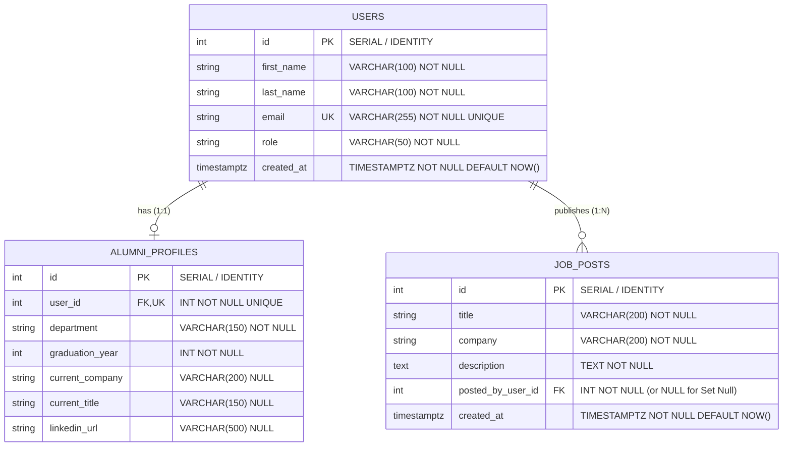

# 📊 Alumni Tracking System — Data Design & Database Architecture

> **Doküman Türü:** Veri Modeli ve Veritabanı Mimari Şartnamesi (Data Design Specification)  
> **Teknoloji Yığını:** PostgreSQL 16 (`docker-compose` persistent volume: `postgres_data`) & Entity Framework Core (EF Core)  
> **Sürüm:** v1.0 (5. Hafta: Database & ORM Kapsamı)  
> **Durum:** Aktif / Single Source of Truth (SSOT)

---

## 1. 🎯 Genel Bakış ve Mimari Altyapı

Bu doküman, **Alumni Tracking System (Mezun Takip Sistemi)** projesinin ilişkisel veritabanı şemasını, varlık (entity) modellerini, ilişkilerini (cardinality), kısıtlamalarını (constraints) ve silme davranışlarını (delete behaviors) tanımlayan **tek ve bağlayıcı kaynak (Single Source of Truth)** niteliğindedir.

### 1.1 Teknoloji ve Altyapı Standartları
* **Veritabanı Motoru:** **PostgreSQL 16** (`postgres:16-alpine` resmi Docker imajı).
* **Konteyner ve Kalıcılık:** `docker-compose.yml` içerisinde `alumni-db` servisi altında `postgres_data` adlandırılmış volume (named volume) ile `/var/lib/postgresql/data` dizininde tam veri kalıcılığı.
* **ORM (Object-Relational Mapping):** **Entity Framework Core (EF Core)** - Code-First yaklaşımı.
* **Sürücü / Sağlayıcı:** `Npgsql.EntityFrameworkCore.PostgreSQL`.
* **İsimlendirme Konvansiyonu:**
  * **C# / EF Core Katmanı:** `PascalCase` (Örn: `AlumniProfile`, `GraduationYear`, `PostedByUserId`).
  * **PostgreSQL Veritabanı Katmanı:** `snake_case` (Örn: `alumni_profiles`, `graduation_year`, `posted_by_user_id`).
  * **Tablo İsimleri:** Çoğul (Plural) form (`users`, `alumni_profiles`, `job_posts`).

---

## 2. 🧩 Varlık-İlişki Diyagramı (Entity-Relationship Diagram - ERD)

Aşağıdaki Mermaid ER şeması sistemin temel varlıklarını, birincil (PK) ve yabancı (FK) anahtarlarını, veri tiplerini ve kardinalitelerini göstermektedir:



---

## 3. 📋 Varlık Modelleri ve Nitelikler (Entities & Attributes)

### 3.1 `Users` Tablosu (`users`)
Platforma kaydolan tüm aktörlerin (Mezun, Yönetici, İşveren vb.) kimlik ve kimlik doğrulama temel bilgilerini tutar.

| Sütun Adı (DB) | C# Özellik Adı | Veri Tipi (PostgreSQL) | C# Tipi | Boş Olabilir? | Kısıt / İndeks | Açıklama |
| :--- | :--- | :--- | :--- | :--- | :--- | :--- |
| `id` | `Id` | `SERIAL` / `INTEGER` | `int` | **Hayır (PK)** | `PRIMARY KEY` | Benzersiz kullanıcı tanımlayıcısı |
| `first_name` | `FirstName` | `VARCHAR(100)` | `string` | **Hayır** | `NOT NULL` | Kullanıcının adı |
| `last_name` | `LastName` | `VARCHAR(100)` | `string` | **Hayır** | `NOT NULL` | Kullanıcının soyadı |
| `email` | `Email` | `VARCHAR(255)` | `string` | **Hayır** | `UNIQUE INDEX` | Benzersiz ve doğrulanmış e-posta adresi |
| `role` | `Role` | `VARCHAR(50)` | `string` | **Hayır** | `DEFAULT 'Alumni'` | Sistem rolü (`Admin`, `Alumni`, `Employer`) |
| `created_at` | `CreatedAt` | `TIMESTAMPTZ` | `DateTime` | **Hayır** | `DEFAULT NOW()` | Kayıt oluşturulma zamanı (UTC) |

---

### 3.2 `AlumniProfiles` Tablosu (`alumni_profiles`)
Mezun rolündeki kullanıcılara ait akademik geçmiş ve profesyonel kariyer detaylarını saklar.

| Sütun Adı (DB) | C# Özellik Adı | Veri Tipi (PostgreSQL) | C# Tipi | Boş Olabilir? | Kısıt / İndeks | Açıklama |
| :--- | :--- | :--- | :--- | :--- | :--- | :--- |
| `id` | `Id` | `SERIAL` / `INTEGER` | `int` | **Hayır (PK)** | `PRIMARY KEY` | Profil benzersiz tanımlayıcısı |
| `user_id` | `UserId` | `INTEGER` | `int` | **Hayır (FK)** | `FOREIGN KEY`, `UNIQUE` | Bağlı olduğu `Users.Id` (1-e-1 ilişki) |
| `department` | `Department` | `VARCHAR(150)` | `string` | **Hayır** | `NOT NULL` | Mezun olunan üniversite bölümü |
| `graduation_year`| `GraduationYear`| `INTEGER` | `int` | **Hayır** | `CHECK (1950 - 2100)` | Mezuniyet yılı |
| `current_company`| `CurrentCompany`| `VARCHAR(200)` | `string?` | Evet | — | Şu an çalışılan kurum/şirket |
| `current_title` | `CurrentTitle` | `VARCHAR(150)` | `string?` | Evet | — | Şu anki pozisyon/unvan |
| `linkedin_url` | `LinkedInUrl` | `VARCHAR(500)` | `string?` | Evet | Format doğrulaması | LinkedIn profil bağlantısı |

---

### 3.3 `JobPosts` Tablosu (`job_posts`)
Mezunlar veya kariyer merkezi yetkilileri tarafından paylaşılan iş/staj ilanlarını barındırır.

| Sütun Adı (DB) | C# Özellik Adı | Veri Tipi (PostgreSQL) | C# Tipi | Boş Olabilir? | Kısıt / İndeks | Açıklama |
| :--- | :--- | :--- | :--- | :--- | :--- | :--- |
| `id` | `Id` | `SERIAL` / `INTEGER` | `int` | **Hayır (PK)** | `PRIMARY KEY` | İlan benzersiz tanımlayıcısı |
| `title` | `Title` | `VARCHAR(200)` | `string` | **Hayır** | `NOT NULL` | İlan başlığı (Örn: Senior .NET Developer) |
| `company` | `Company` | `VARCHAR(200)` | `string` | **Hayır** | `NOT NULL` | İlanı veren firma adı |
| `description` | `Description` | `TEXT` | `string` | **Hayır** | `NOT NULL` | İlanın detaylı açıklaması ve şartlar |
| `posted_by_user_id` | `PostedByUserId` | `INTEGER` | `int` (veya `int?`)| **Model Tercihine Bağlı** | `FOREIGN KEY`, `INDEX` | İlanı açan kullanıcı (`Users.Id`) |
| `created_at` | `CreatedAt` | `TIMESTAMPTZ` | `DateTime` | **Hayır** | `DEFAULT NOW()` | İlan paylaşım zamanı (UTC) |

---

## 4. 🔗 İlişkiler, Kardinalite ve Silme Davranışları (Relationships & Delete Behaviors)

### 4.1 `Users` ↔ `AlumniProfiles` (1-to-1 İlişkisi)
* **Kardinalite:** `1 : 0..1` (Her kullanıcının en fazla bir mezun profili olabilir; her profil tam olarak bir kullanıcıya aittir).
* **Yabancı Anahtar:** `alumni_profiles.user_id` -> `users.id`.
* **Birebir Kısıtlaması:** `alumni_profiles.user_id` üzerinde **UNIQUE Index** tanımlanarak tekillik garanti altına alınır.
* **Silme Davranışı (Delete Behavior):**
  * **`Cascade` (`DeleteBehavior.Cascade`):** Bir `User` kaydı silindiğinde, o kullanıcıya ait `AlumniProfile` kaydının sistemde anlamsız (orphan) kalmaması için profil de **otomatik olarak veritabanından silinir**.

### 4.2 `Users` ↔ `JobPosts` (1-to-N İlişkisi)
* **Kardinalite:** `1 : 0..N` (Bir kullanıcı sıfır, bir veya birden fazla iş ilanı paylaşabilir; paylaşılan bir iş ilanı bir kullanıcı tarafından açılmıştır).
* **Yabancı Anahtar:** `job_posts.posted_by_user_id` -> `users.id`.
* **Silme Davranışları ve Stratejik Tercihler:**
  1. **Cascade Silme (Ön Tanımlı - Standard Clean Deletion):**
     * **EF Core Ayarı:** `OnDelete(DeleteBehavior.Cascade)`
     * **Açıklama:** Kullanıcı hesabı sistemden kaldırıldığında, yayınladığı tüm iş ilanları da otomatik olarak silinir. Test ortamlarında ve veri temizliği odaklı süreçlerde önerilir.
  2. **Set Null Silme (Kurumsal Arşivleme - Institutional Retention):**
     * **EF Core Ayarı:** `OnDelete(DeleteBehavior.SetNull)`
     * **Açıklama:** İş ilanlarının kurumsal hafıza veya başvuran diğer mezunların mağdur olmaması adına yayında kalması istendiğinde, `job_posts.posted_by_user_id` kolonu `NULL` kabul edecek şekilde tasarlanır (`int? PostedByUserId`). Kullanıcı silindiğinde ilan silinmez, sadece ilanı açan alan `NULL` (Anonim / Kariyer Merkezi) değerini alır.

---

## 5. 🛡️ Kısıtlamalar, İndeksler ve Performans (Constraints & Indexes)

| Tablo | İndeks / Kısıt Adı | Hedef Kolon(lar) | Tür | Amaç / Gerekçe |
| :--- | :--- | :--- | :--- | :--- |
| `users` | `pk_users` | `id` | `PRIMARY KEY` (B-Tree) | Hızlı satır erişimi ve kümeleme (Clustering). |
| `users` | `ix_users_email` | `email` | `UNIQUE INDEX` | E-posta tekilliğini garanti altına alma ve oturum açma sorgularını hızlandırma. |
| `alumni_profiles`| `pk_alumni_profiles` | `id` | `PRIMARY KEY` (B-Tree) | Profil tekil anahtarı. |
| `alumni_profiles`| `ix_alumni_profiles_user_id` | `user_id` | `UNIQUE INDEX` | 1-to-1 ilişkiyi garanti altına alma ve JOIN optimizasyonu. |
| `alumni_profiles`| `chk_alumni_profiles_grad_year` | `graduation_year` | `CHECK CONSTRAINT` | Mantıksız mezuniyet yılı girişlerini engelleme (`graduation_year >= 1950 AND graduation_year <= 2100`). |
| `job_posts` | `pk_job_posts` | `id` | `PRIMARY KEY` (B-Tree) | İlan tekil anahtarı. |
| `job_posts` | `ix_job_posts_posted_by_user_id` | `posted_by_user_id` | `INDEX` (B-Tree) | Kullanıcının paylaştığı ilanları listelerken veya JOIN işlemlerinde arama maliyetini düşürme. |

---

## 6. ⚙️ Entity Framework Core (EF Core) Fluent API Konfigürasyon Taslağı

`Alumni.Persistence` katmanı altında `IEntityTypeConfiguration<T>` kullanılarak uygulanacak kurumsal Fluent API konfigürasyon taslağı:

```csharp
using Alumni.Domain.Entities;
using Microsoft.EntityFrameworkCore;
using Microsoft.EntityFrameworkCore.Metadata.Builders;

namespace Alumni.Persistence.Configurations
{
    // 1. User Configuration
    public class UserConfiguration : IEntityTypeConfiguration<User>
    {
        public void Configure(EntityTypeBuilder<User> builder)
        {
            builder.ToTable("users");

            builder.HasKey(u => u.Id).HasName("pk_users");
            builder.Property(u => u.Id).HasColumnName("id").ValueGeneratedOnAdd();

            builder.Property(u => u.FirstName).HasColumnName("first_name").HasMaxLength(100).IsRequired();
            builder.Property(u => u.LastName).HasColumnName("last_name").HasMaxLength(100).IsRequired();
            builder.Property(u => u.Email).HasColumnName("email").HasMaxLength(255).IsRequired();
            builder.HasIndex(u => u.Email).IsUnique().HasDatabaseName("ix_users_email");

            builder.Property(u => u.Role).HasColumnName("role").HasMaxLength(50).IsRequired().HasDefaultValue("Alumni");
            builder.Property(u => u.CreatedAt).HasColumnName("created_at").HasDefaultValueSql("CURRENT_TIMESTAMP");

            // 1-to-1 Relationship with AlumniProfile (Cascade Delete)
            builder.HasOne(u => u.Profile)
                   .WithOne(p => p.User)
                   .HasForeignKey<AlumniProfile>(p => p.UserId)
                   .OnDelete(DeleteBehavior.Cascade);

            // 1-to-N Relationship with JobPosts
            builder.HasMany(u => u.JobPosts)
                   .WithOne(j => j.PostedByUser)
                   .HasForeignKey(j => j.PostedByUserId)
                   .OnDelete(DeleteBehavior.Cascade); // veya arşiv modeli için DeleteBehavior.SetNull
        }
    }

    // 2. AlumniProfile Configuration
    public class AlumniProfileConfiguration : IEntityTypeConfiguration<AlumniProfile>
    {
        public void Configure(EntityTypeBuilder<AlumniProfile> builder)
        {
            builder.ToTable("alumni_profiles");

            builder.HasKey(p => p.Id).HasName("pk_alumni_profiles");
            builder.Property(p => p.Id).HasColumnName("id").ValueGeneratedOnAdd();

            builder.Property(p => p.UserId).HasColumnName("user_id").IsRequired();
            builder.HasIndex(p => p.UserId).IsUnique().HasDatabaseName("ix_alumni_profiles_user_id");

            builder.Property(p => p.Department).HasColumnName("department").HasMaxLength(150).IsRequired();
            builder.Property(p => p.GraduationYear).HasColumnName("graduation_year").IsRequired();
            builder.Property(p => p.CurrentCompany).HasColumnName("current_company").HasMaxLength(200).IsRequired(false);
            builder.Property(p => p.CurrentTitle).HasColumnName("current_title").HasMaxLength(150).IsRequired(false);
            builder.Property(p => p.LinkedInUrl).HasColumnName("linkedin_url").HasMaxLength(500).IsRequired(false);
        }
    }

    // 3. JobPost Configuration
    public class JobPostConfiguration : IEntityTypeConfiguration<JobPost>
    {
        public void Configure(EntityTypeBuilder<JobPost> builder)
        {
            builder.ToTable("job_posts");

            builder.HasKey(j => j.Id).HasName("pk_job_posts");
            builder.Property(j => j.Id).HasColumnName("id").ValueGeneratedOnAdd();

            builder.Property(j => j.Title).HasColumnName("title").HasMaxLength(200).IsRequired();
            builder.Property(j => j.Company).HasColumnName("company").HasMaxLength(200).IsRequired();
            builder.Property(j => j.Description).HasColumnName("description").HasColumnType("text").IsRequired();
            builder.Property(j => j.PostedByUserId).HasColumnName("posted_by_user_id").IsRequired();
            builder.HasIndex(j => j.PostedByUserId).HasDatabaseName("ix_job_posts_posted_by_user_id");

            builder.Property(j => j.CreatedAt).HasColumnName("created_at").HasDefaultValueSql("CURRENT_TIMESTAMP");
        }
    }
}
```

---

## 7. 🐘 PostgreSQL 16 DDL Şema Karşılığı (Reference SQL)

Aşağıdaki SQL betiği, PostgreSQL 16 üzerinde doğrudan çalıştırılabilecek eşdeğer DDL şemasını temsil eder:

```sql
-- 1. Users Tablosu
CREATE TABLE IF NOT EXISTS users (
    id SERIAL PRIMARY KEY,
    first_name VARCHAR(100) NOT NULL,
    last_name VARCHAR(100) NOT NULL,
    email VARCHAR(255) NOT NULL,
    role VARCHAR(50) NOT NULL DEFAULT 'Alumni',
    created_at TIMESTAMPTZ NOT NULL DEFAULT CURRENT_TIMESTAMP,
    CONSTRAINT uq_users_email UNIQUE (email)
);

CREATE INDEX IF NOT EXISTS ix_users_email ON users(email);

-- 2. Alumni Profiles Tablosu (1-to-1)
CREATE TABLE IF NOT EXISTS alumni_profiles (
    id SERIAL PRIMARY KEY,
    user_id INT NOT NULL UNIQUE,
    department VARCHAR(150) NOT NULL,
    graduation_year INT NOT NULL,
    current_company VARCHAR(200),
    current_title VARCHAR(150),
    linkedin_url VARCHAR(500),
    CONSTRAINT fk_alumni_profiles_users FOREIGN KEY (user_id) 
        REFERENCES users(id) ON DELETE CASCADE,
    CONSTRAINT chk_alumni_profiles_grad_year CHECK (graduation_year >= 1950 AND graduation_year <= 2100)
);

CREATE UNIQUE INDEX IF NOT EXISTS ix_alumni_profiles_user_id ON alumni_profiles(user_id);

-- 3. Job Posts Tablosu (1-to-N)
CREATE TABLE IF NOT EXISTS job_posts (
    id SERIAL PRIMARY KEY,
    title VARCHAR(200) NOT NULL,
    company VARCHAR(200) NOT NULL,
    description TEXT NOT NULL,
    posted_by_user_id INT NOT NULL,
    created_at TIMESTAMPTZ NOT NULL DEFAULT CURRENT_TIMESTAMP,
    CONSTRAINT fk_job_posts_users FOREIGN KEY (posted_by_user_id) 
        REFERENCES users(id) ON DELETE CASCADE
);

CREATE INDEX IF NOT EXISTS ix_job_posts_posted_by_user_id ON job_posts(posted_by_user_id);
```

---

## 8. 🌱 Factory ve Veritabanı Tohumlama (Seed) Sistemi

Sistemin geliştirme, test ve ilk canlıya alma aşamalarında ilişkisel bütünlüğe sahip verilerle ayağa kalkmasını sağlamak üzere **Factory Pattern** ve **Idempotent Database Seeder** mimarisi uygulanmıştır.

### 8.1 Fabrika Sınıfları (Factories) — `Alumni.Persistence/Seed/Factories/`
Fabrika sınıflarının temel amacı, `DATA_DESIGN.md` standartlarına ve kısıtlamalarına tam uyumlu, tutarlı varlık örnekleri (instances) üretmektir:

1. **`UserFactory`**:
   - `Admin`, `Alumni` ve `Employer` rollerine uygun doğrulanmış kullanıcılar üretir.
   - E-posta adreslerini küçük harfe ve tekil formata normalize eder (`ix_users_email`).
2. **`AlumniProfileFactory`**:
   - `chk_alumni_profiles_grad_year` kısıtını (1950 - 2100) derleme/çalışma anında denetler.
   - `Users` ile 1-to-1 ilişkili profil modelleri üretir.
3. **`JobPostFactory`**:
   - İlanı açan kullanıcı (`posted_by_user_id`) ile 1-to-N yabancı anahtar ilişkisini kurarak iş ilanları üretir.
4. **`AnnouncementFactory`**:
   - Sistem ve mezunlar buluşması duyurularını üretir.

### 8.2 Tohumlama Mekanizması (Seeder) — `Alumni.Persistence/Seed/DatabaseSeeder.cs`
- **Tetiklenme:** ASP.NET Core başlatma aşamasında (`Program.cs`) DI scope'u üzerinden otomatik çağrılır.
- **Idempotency (Tekrarlanabilirlik Güvencesi):** `context.Users.AnyAsync()` kontrolü ile veritabanında önceden kayıt varsa tohumlama işlemi güvenle atlanır, mükerrer veri engellenir.
- **İlişkisel Kayıt Sırası:** Önce `Users` kaydedilerek `Id`'ler elde edilir, ardından türeyen `AlumniProfiles` ve `JobPosts` kayıtları yabancı anahtarlara bağlanarak saklanır.

---

## 9. 🤖 AI & Antigravity Assistant Directive (Data Single Source of Truth)

> [!IMPORTANT]
> **AI / Antigravity Assistant Directive (Data Single Source of Truth):**  
> All entity models, DTOs, migrations, and database schema modifications MUST strictly reference and adhere to [DATA_DESIGN.md](./DATA_DESIGN.md). Whenever a database table, entity, property, or relationship is added, updated, or deleted in the codebase, the AI assistant MUST keep `DATA_DESIGN.md` synchronized and updated as the single source of truth.

