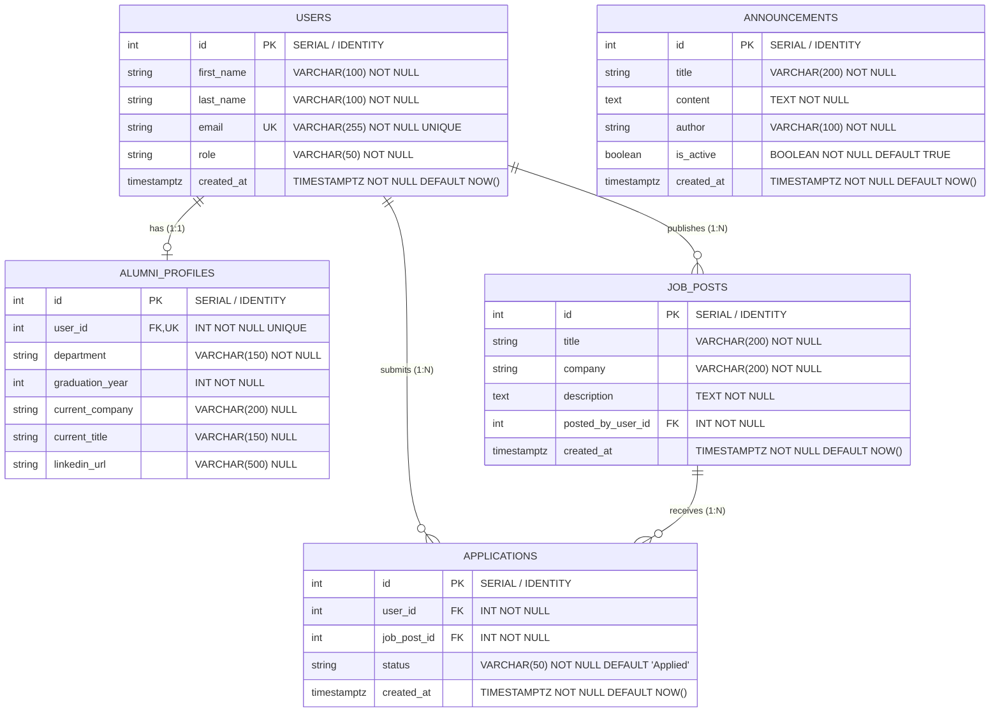

# 📊 Alumni Tracking System — Data Design & Database Architecture

> **Doküman Türü:** Veri Modeli ve Veritabanı Mimari Şartnamesi (Data Design Specification / ddd.md)  
> **Teknoloji Yığını:** PostgreSQL 16 (`docker-compose` persistent volume: `postgres_data`) & Entity Framework Core (EF Core)  
> **Sürüm:** v1.1 (6. Hafta: Relational Data, Nested Routing, Job Postings & Applications Kapsamı)  
> **Durum:** Aktif / Single Source of Truth (SSOT)

---

## 1. 🎯 Genel Bakış ve Mimari Altyapı

Bu doküman, **Alumni Tracking System (Mezun Takip Sistemi)** projesinin ilişkisel veritabanı şemasını, varlık (entity) modellerini, ilişkilerini (cardinality), kısıtlamalarını (constraints), silme davranışlarını (delete behaviors) ve iç içe uç nokta (nested routing) sözleşmelerini tanımlayan **tek ve bağlayıcı kaynak (Single Source of Truth)** niteliğindedir.

### 1.1 Teknoloji ve Altyapı Standartları
* **Veritabanı Motoru:** **PostgreSQL 16** (`postgres:16-alpine` resmi Docker imajı).
* **Konteyner ve Kalıcılık:** `docker-compose.yml` içerisinde `alumni-db` servisi altında `postgres_data` adlandırılmış volume (named volume) ile `/var/lib/postgresql/data` dizininde tam veri kalıcılığı.
* **ORM (Object-Relational Mapping):** **Entity Framework Core (EF Core)** - Code-First yaklaşımı.
* **Sürücü / Sağlayıcı:** `Npgsql.EntityFrameworkCore.PostgreSQL`.
* **İsimlendirme Konvansiyonu:**
  * **C# / EF Core Katmanı:** `PascalCase` (Örn: `AlumniProfile`, `JobPost`, `Application`, `PostedByUserId`).
  * **PostgreSQL Veritabanı Katmanı:** `snake_case` (Örn: `alumni_profiles`, `job_posts`, `applications`, `posted_by_user_id`).
  * **Tablo İsimleri:** Çoğul (Plural) form (`users`, `alumni_profiles`, `job_posts`, `applications`, `announcements`).

---

## 2. 🧩 Varlık-İlişki Diyagramı (Entity-Relationship Diagram - ERD)

Aşağıdaki Mermaid ER şeması sistemin temel varlıklarını, birincil (PK) ve yabancı (FK) anahtarlarını, veri tiplerini, 1:1, 1:N ve M:N (Join Table üzerinden) kardinalitelerini göstermektedir:



> **Not:** `USERS` ve `JOB_POSTS` arasındaki çoka-çok (**Many-to-Many**) ilişki, bir ara tablo (Join Table) olan `APPLICATIONS` tablosu üzerinden kurulur. Bir satır tam olarak bir `(user_id, job_post_id)` çiftini temsil eder.

---

## 3. 📋 Varlık Modelleri ve Nitelikler (Entities & Attributes)

### 3.1 `Users` Tablosu (`users`)
Platforma kaydolan tüm aktörlerin (Mezun, Yönetici, İşveren vb.) kimlik ve kimlik doğrulama temel bilgilerini tutar.

| Sütun Adı (DB) | C# Özellik Adı | Veri Tipi (PostgreSQL) | C# Tipi | Boş Olabilir? | Kısıt / İndeks | Açıklama |
| :--- | :--- | :--- | :--- | :--- | :--- | :--- |
| `id` | `Id` | `SERIAL` / `INTEGER` | `int` | **Hayır (PK)** | `PRIMARY KEY` | Benzersiz kullanıcı tanımlayıcısı |
| `first_name` | `FirstName` | `VARCHAR(100)` | `string` | **Hayır** | `NOT NULL` | Kullanıcının adı |
| `last_name` | `LastName` | `VARCHAR(100)` | `string` | **Hayır** | `NOT NULL` | Kullanıcının soyadı |
| `email` | `Email` | `VARCHAR(255)` | `string` | **Hayır** | `UNIQUE INDEX` | Benzersiz e-posta adresi |
| `role` | `Role` | `VARCHAR(50)` | `string` | **Hayır** | `DEFAULT 'Alumni'` | Sistem rolü (`Admin`, `Alumni`, `Employer`) |
| `created_at` | `CreatedAt` | `TIMESTAMPTZ` | `DateTime` | **Hayır** | `DEFAULT NOW()` | Kayıt oluşturulma zamanı (UTC) |

---

### 3.2 `AlumniProfiles` Tablosu (`alumni_profiles`)
Mezun rolündeki kullanıcılara ait akademik geçmiş ve profesyonel kariyer detaylarını saklar.

| Sütun Adı (DB) | C# Özellik Adı | Veri Tipi (PostgreSQL) | C# Tipi | Boş Olabilir? | Kısıt / İndeks | Açıklama |
| :--- | :--- | :--- | :--- | :--- | :--- | :--- |
| `id` | `Id` | `SERIAL` / `INTEGER` | `int` | **Hayır (PK)** | `PRIMARY KEY` | Profil benzersiz tanımlayıcısı |
| `user_id` | `UserId` | `INTEGER` | `int` | **Hayır (FK)** | `FOREIGN KEY`, `UNIQUE` | Bağlı olduğu `Users.Id` (1-e-1 ilişki) |
| `department` | `Department` | `VARCHAR(150)` | `string` | **Hayır** | `NOT NULL` | Mezun olunan üniversite bölümü |
| `graduation_year`| `GraduationYear`| `INTEGER` | `int` | **Hayır** | `CHECK (1950 - 2100)` | Mezuniyet yılı |
| `current_company`| `CurrentCompany`| `VARCHAR(200)` | `string?` | Evet | — | Şu an çalışılan kurum/şirket |
| `current_title` | `CurrentTitle` | `VARCHAR(150)` | `string?` | Evet | — | Şu anki pozisyon/unvan |
| `linkedin_url` | `LinkedInUrl` | `VARCHAR(500)` | `string?` | Evet | Format doğrulaması | LinkedIn profil bağlantısı |

---

### 3.3 `JobPosts` Tablosu (`job_posts` / `job_postings`)
Kullanıcılar veya kariyer merkezi tarafından paylaşılan iş/staj ilanlarını barındırır (1-to-N).

| Sütun Adı (DB) | C# Özellik Adı | Veri Tipi (PostgreSQL) | C# Tipi | Boş Olabilir? | Kısıt / İndeks | Açıklama |
| :--- | :--- | :--- | :--- | :--- | :--- | :--- |
| `id` | `Id` | `SERIAL` / `INTEGER` | `int` | **Hayır (PK)** | `PRIMARY KEY` | İlan benzersiz tanımlayıcısı |
| `title` | `Title` | `VARCHAR(200)` | `string` | **Hayır** | `NOT NULL` | İlan başlığı (Örn: Junior Developer) |
| `company` | `Company` | `VARCHAR(200)` | `string` | **Hayır** | `NOT NULL` | İlanı veren firma adı (Örn: Acme) |
| `description` | `Description` | `TEXT` | `string` | **Hayır** | `NOT NULL` | İlan detayları, gereksinimler |
| `posted_by_user_id` | `PostedByUserId` | `INTEGER` | `int` | **Hayır (FK)** | `FOREIGN KEY`, `INDEX` | İlanı açan kullanıcı (`Users.Id`). Var olmayan kullanıcıya ilan açılamaz! |
| `created_at` | `CreatedAt` | `TIMESTAMPTZ` | `DateTime` | **Hayır** | `DEFAULT NOW()` | İlan paylaşım zamanı (UTC) |

---

### 3.4 `Applications` Tablosu (`applications` - Join Table)
Kullanıcıların iş ilanlarına yaptığı başvuruları tutar (Many-to-Many çözümleyici ara tablo).

| Sütun Adı (DB) | C# Özellik Adı | Veri Tipi (PostgreSQL) | C# Tipi | Boş Olabilir? | Kısıt / İndeks | Açıklama |
| :--- | :--- | :--- | :--- | :--- | :--- | :--- |
| `id` | `Id` | `SERIAL` / `INTEGER` | `int` | **Hayır (PK)** | `PRIMARY KEY` | Başvuru kayıt numarası |
| `user_id` | `UserId` | `INTEGER` | `int` | **Hayır (FK)** | `FOREIGN KEY`, `INDEX` | Başvuran kullanıcı (`Users.Id`) |
| `job_post_id` | `JobPostId` | `INTEGER` | `int` | **Hayır (FK)** | `FOREIGN KEY`, `INDEX` | Başvurulan iş ilanı (`JobPosts.Id`) |
| `status` | `Status` | `VARCHAR(50)` | `string` | **Hayır** | `DEFAULT 'Applied'` | Başvuru durumu (`Applied`, `Reviewing`, `Interview`, `Accepted`, `Rejected`) |
| `created_at` | `CreatedAt` | `TIMESTAMPTZ` | `DateTime` | **Hayır** | `DEFAULT NOW()` | Başvuru oluşturulma zamanı (UTC) |

> 🔒 **Tekil Çift Kuralı (Unique Pair Constraint):**  
> `UNIQUE (user_id, job_post_id)` kısıtlaması sayesinde aynı kullanıcı aynı ilana **yalnızca bir kez** başvurabilir. Mükerrer başvuru durumunda veritabanı kısıt hatası verir, API katmanı **`409 Conflict`** yanıtı döner.

---

## 4. 🔗 İlişkiler, Kardinalite ve Silme Davranışları (Relationships & Delete Behaviors)

### 4.1 `Users` ↔ `AlumniProfiles` (1-to-1)
* **Kardinalite:** `1 : 0..1` (Her kullanıcının en fazla bir mezun profili olabilir).
* **Yabancı Anahtar:** `alumni_profiles.user_id` -> `users.id`.
* **Silme Kuralı:** **`Cascade`**. Kullanıcı silindiğinde profil de sistemden tamamen temizlenir.

---

### 4.2 `Users` ↔ `JobPosts` (1-to-N) — İlan Açma İlişkisi ve Silme Kararı
* **Kardinalite:** `1 : 0..N` (Bir kullanıcı birden çok iş ilanı yayınlayabilir; her ilan mutlaka bir kullanıcıya aittir).
* **Yabancı Anahtar:** `job_posts.posted_by_user_id` -> `users.id` (PostgreSQL ve EF Core düzeyinde zorunlu FK).
* **Silme Davranışı Kararı (Delete Rule Decision):**
  * **Seçilen Strateji: `Restrict` (`DeleteBehavior.Restrict` / HTTP 409 Conflict)**
  * **Mimari ve İş Gerekçesi:**  
    Bir kullanıcının (mezun veya işveren) yayınlamış olduğu iş ilanları mevcutken ve bu ilanlara diğer mezunlar başvurmuş olabileceğinden, ilan sahibinin doğrudan silinmesi kurumsal hafızanın ve aday başvurularının beklenmedik biçimde yok olmasına (veri kaybı) yol açar.  
    Bu nedenle `Users` tablosundan bir kayıt silinmek istendiğinde:
    1. Eğer kullanıcının yayınladığı ilanlar varsa veritabanı kısıtı devreye girer veya controller katmanı bu durumu kontrol eder.
    2. İstek reddedilir ve istemciye **`409 Conflict`** ("Kullanıcıya ait iş ilanları bulunmaktadır. Önce ilanları kaldırınız.") yanıtı dönülür.
    3. Böylece kaza eseri toplu veri silinmesinin (accidental cascade) önüne geçilir.
  * *(Geliştirme / Test Amaçlı Alternatif - Cascade):* Test suite'lerinde veya izole ortamlarda `Cascade` çalıştırılabilir, ancak üretim şartnamesi olarak **`Restrict`** esastır.

---

### 4.3 `JobPosts` ↔ `Applications` ↔ `Users` (Many-to-Many)
* **Kardinalite:**
  * `Users (1) ──< Applications (N)`
  * `JobPosts (1) ──< Applications (N)`
* **Join Table:** `applications`.
* **Silme Davranışları:**
  1. **İlan Silindiğinde (`JobPost` silinirse):** **`Cascade`**. İlan yayından kalktığında o ilana yapılan başvuruların açıkta kalmaması için başvurular da otomatik olarak silinir.
  2. **Başvuran Kullanıcı Silindiğinde (`User` silinirse):** Kullanıcının hiçbir ilanı yoksa ancak yalnızca başvuruları varsa, başvuruları **`Cascade`** ile temizlenebilir veya kullanıcı silinmeden önce başvuruları geri çekilebilir.

---

## 5. 🛡️ Kısıtlamalar, İndeksler ve Performans (Constraints & Indexes)

| Tablo | İndeks / Kısıt Adı | Hedef Kolon(lar) | Tür | Amaç / Gerekçe |
| :--- | :--- | :--- | :--- | :--- |
| `users` | `pk_users` | `id` | `PRIMARY KEY` | Tekil satır tanımlayıcısı |
| `users` | `ix_users_email` | `email` | `UNIQUE INDEX` | E-posta tekilliği ve hızlı sorgulama |
| `alumni_profiles`| `pk_alumni_profiles` | `id` | `PRIMARY KEY` | Profil anahtarı |
| `alumni_profiles`| `ix_alumni_profiles_user_id` | `user_id` | `UNIQUE INDEX` | 1-to-1 tekillik garantisi |
| `alumni_profiles`| `chk_alumni_profiles_grad_year` | `graduation_year` | `CHECK` | 1950 - 2100 yıl aralığı doğrulaması |
| `job_posts` | `pk_job_posts` | `id` | `PRIMARY KEY` | İlan anahtarı |
| `job_posts` | `ix_job_posts_posted_by_user_id`| `posted_by_user_id` | `INDEX` | Kullanıcı bazlı ilan aramalarını hızlandırma |
| `job_posts` | `fk_job_posts_users` | `posted_by_user_id` | `FOREIGN KEY` | Var olmayan kullanıcıya ilan açılmasını engelleme |
| `applications` | `pk_applications` | `id` | `PRIMARY KEY` | Başvuru anahtarı |
| `applications` | `uq_applications_user_job` | `user_id`, `job_post_id` | **`UNIQUE INDEX`** | **Aynı kullanıcının aynı ilana ikinci kez başvurmasını engelleme (409 Conflict)** |
| `applications` | `ix_applications_user_id` | `user_id` | `INDEX` | Bir kullanıcının yaptığı başvuruları getirme |
| `applications` | `ix_applications_job_post_id` | `job_post_id` | `INDEX` | Bir ilana gelen başvuruları getirme |
| `applications` | `chk_applications_status` | `status` | `CHECK` | Geçerli durum kodları kontrolü (`Applied`, `Reviewing`, `Interview`, `Accepted`, `Rejected`) |

---

## 6. 🌐 Gelişmiş Yönlendirme ve REST API Sözleşmeleri (Advanced Routing Specification)

Hafta 06 kapsamında uygulanacak iç içe yönlendirme (nested routes), eager loading (include) ve HTTP durum kodu kuralları:

### 6.1 Kullanıcı ve İlan Yönlendirmeleri (Nested Routes)
* **`POST /api/users/{id}/jobs`**
  * **İşlev:** Belirtilen kullanıcı adına yeni bir iş ilanı oluşturur.
  * **Önemli Kural:** İlanı açan kullanıcının kimliği gövdeden (body) **değil**, doğrudan URL yol parametresinden (`{id}`) alınır.
  * **Yanıtlar:**
    * `201 Created` — İlan başarıyla oluşturuldu (oluşturulan ilan nesnesi gövdede döner).
    * `404 Not Found` — Verilen `{id}` değerine sahip kullanıcı veritabanında bulunamadı.
    * `400 Bad Request` — Eksik veya geçersiz alanlar (başlık, şirket veya açıklama boş).

* **`GET /api/users/{id}/jobs`**
  * **İşlev:** Belirtilen kullanıcının açtığı tüm iş ilanlarını listeler.
  * **Yanıtlar:**
    * `200 OK` — İlan dizisi döner (ilan yoksa boş liste `[]` döner).
    * `404 Not Found` — Belirtilen kullanıcı mevcut değil.

* **`GET /api/users/{id}` (Include / Join Kuralı)**
  * **İşlev:** Kullanıcı detayını getirirken, ilişkili olduğu iş ilanlarını da tek yanıtta `jobs` dizisi olarak dahil eder (`Eager Loading / LEFT JOIN`).
  * **Örnek Yanıt:**
    ```json
    {
      "id": 1,
      "firstName": "Ada",
      "lastName": "Lovelace",
      "email": "ada@iu.edu.tr",
      "role": "Alumni",
      "jobs": [
        {
          "id": 10,
          "title": "Backend Intern",
          "company": "Acme",
          "createdAt": "2026-10-21T09:00:00Z"
        }
      ]
    }
    ```
  * **Önemli Kural:** Kullanıcının hiç ilanı yoksa bile kullanıcı bilgisi eksiksiz döner ve `"jobs": []` şeklinde boş dizi barındırır (`LEFT JOIN` davranışı).

* **`DELETE /api/users/{id}` (Silme Kuralı Davranışı)**
  * Kullanıcının aktif ilanları varsa silme işlemi engellenir ve **`409 Conflict`** döner (`Restrict` kuralı).
  * Kullanıcının ilanı yoksa silinir ve **`204 No Content`** döner.

---

### 6.2 Başvuru Yönlendirmeleri (Applications Routes)
* **`POST /api/jobs/{id}/applications`**
  * **İşlev:** Belirtilen iş ilanına bir kullanıcı adına başvuru yapar (`{ "userId": 3 }`).
  * **Yanıtlar:**
    * `201 Created` — Başvuru başarıyla alındı.
    * `404 Not Found` — İlan (`{id}`) veya başvuran kullanıcı (`userId`) veritabanında yok.
    * `409 Conflict` — **Mükerrer Başvuru:** Bu kullanıcı bu ilana daha önce başvurmuş (`UNIQUE (user_id, job_post_id)`).

* **`GET /api/jobs/{id}/applications`**
  * **İşlev:** Bir ilana başvuran tüm adayların ve başvuru tarihlerinin listesini döner.

* **`GET /api/users/{id}/applications`**
  * **İşlev:** Bir kullanıcının başvurduğu tüm iş ilanlarının ve başvuru statülerinin listesini döner.

---

## 7. ⚙️ Entity Framework Core (EF Core) Fluent API Konfigürasyon Taslağı

```csharp
using Alumni.Domain.Entities;
using Microsoft.EntityFrameworkCore;
using Microsoft.EntityFrameworkCore.Metadata.Builders;

namespace Alumni.Persistence.Configurations
{
    // 1. User Configuration
    public class UserConfiguration : IEntityTypeConfiguration<User>
    {
        public void Configure(EntityTypeBuilder<User> builder)
        {
            builder.ToTable("users");

            builder.HasKey(u => u.Id).HasName("pk_users");
            builder.Property(u => u.Id).HasColumnName("id").ValueGeneratedOnAdd();

            builder.Property(u => u.FirstName).HasColumnName("first_name").HasMaxLength(100).IsRequired();
            builder.Property(u => u.LastName).HasColumnName("last_name").HasMaxLength(100).IsRequired();
            builder.Property(u => u.Email).HasColumnName("email").HasMaxLength(255).IsRequired();
            builder.HasIndex(u => u.Email).IsUnique().HasDatabaseName("ix_users_email");

            builder.Property(u => u.Role).HasColumnName("role").HasMaxLength(50).IsRequired().HasDefaultValue("Alumni");
            builder.Property(u => u.CreatedAt).HasColumnName("created_at").HasDefaultValueSql("CURRENT_TIMESTAMP");

            // 1-to-1 Relationship with AlumniProfile (Cascade Delete)
            builder.HasOne(u => u.Profile)
                   .WithOne(p => p.User)
                   .HasForeignKey<AlumniProfile>(p => p.UserId)
                   .OnDelete(DeleteBehavior.Cascade);

            // 1-to-N Relationship with JobPosts (Restrict Delete - ddd.md kararı)
            builder.HasMany(u => u.JobPosts)
                   .WithOne(j => j.PostedByUser)
                   .HasForeignKey(j => j.PostedByUserId)
                   .OnDelete(DeleteBehavior.Restrict);

            // 1-to-N Relationship with Applications
            builder.HasMany(u => u.Applications)
                   .WithOne(a => a.User)
                   .HasForeignKey(a => a.UserId)
                   .OnDelete(DeleteBehavior.Cascade);
        }
    }

    // 2. JobPost Configuration
    public class JobPostConfiguration : IEntityTypeConfiguration<JobPost>
    {
        public void Configure(EntityTypeBuilder<JobPost> builder)
        {
            builder.ToTable("job_posts");

            builder.HasKey(j => j.Id).HasName("pk_job_posts");
            builder.Property(j => j.Id).HasColumnName("id").ValueGeneratedOnAdd();

            builder.Property(j => j.Title).HasColumnName("title").HasMaxLength(200).IsRequired();
            builder.Property(j => j.Company).HasColumnName("company").HasMaxLength(200).IsRequired();
            builder.Property(j => j.Description).HasColumnName("description").HasColumnType("text").IsRequired();
            builder.Property(j => j.PostedByUserId).HasColumnName("posted_by_user_id").IsRequired();
            builder.HasIndex(j => j.PostedByUserId).HasDatabaseName("ix_job_posts_posted_by_user_id");

            builder.Property(j => j.CreatedAt).HasColumnName("created_at").HasDefaultValueSql("CURRENT_TIMESTAMP");

            // 1-to-N Relationship with Applications (İlan silinince başvuruları silinsin: Cascade)
            builder.HasMany(j => j.Applications)
                   .WithOne(a => a.JobPost)
                   .HasForeignKey(a => a.JobPostId)
                   .OnDelete(DeleteBehavior.Cascade);
        }
    }

    // 3. Application Configuration (Join Table / Entity)
    public class ApplicationConfiguration : IEntityTypeConfiguration<Application>
    {
        public void Configure(EntityTypeBuilder<Application> builder)
        {
            builder.ToTable("applications");

            builder.HasKey(a => a.Id).HasName("pk_applications");
            builder.Property(a => a.Id).HasColumnName("id").ValueGeneratedOnAdd();

            builder.Property(a => a.UserId).HasColumnName("user_id").IsRequired();
            builder.Property(a => a.JobPostId).HasColumnName("job_post_id").IsRequired();

            builder.Property(a => a.Status).HasColumnName("status").HasMaxLength(50).IsRequired().HasDefaultValue("Applied");
            builder.Property(a => a.CreatedAt).HasColumnName("created_at").HasDefaultValueSql("CURRENT_TIMESTAMP");

            // Unique Pair Constraint: UNIQUE (user_id, job_post_id)
            builder.HasIndex(a => new { a.UserId, a.JobPostId })
                   .IsUnique()
                   .HasDatabaseName("ix_applications_user_id_job_post_id");

            builder.HasIndex(a => a.UserId).HasDatabaseName("ix_applications_user_id");
            builder.HasIndex(a => a.JobPostId).HasDatabaseName("ix_applications_job_post_id");

            builder.HasOne(a => a.User)
                   .WithMany(u => u.Applications)
                   .HasForeignKey(a => a.UserId)
                   .OnDelete(DeleteBehavior.Cascade);

            builder.HasOne(a => a.JobPost)
                   .WithMany(j => j.Applications)
                   .HasForeignKey(a => a.JobPostId)
                   .OnDelete(DeleteBehavior.Cascade);
        }
    }
}
```

---

## 8. 🐘 PostgreSQL 16 DDL Şema Karşılığı (Reference SQL)

```sql
-- 1. Users Tablosu
CREATE TABLE IF NOT EXISTS users (
    id SERIAL PRIMARY KEY,
    first_name VARCHAR(100) NOT NULL,
    last_name VARCHAR(100) NOT NULL,
    email VARCHAR(255) NOT NULL,
    role VARCHAR(50) NOT NULL DEFAULT 'Alumni',
    created_at TIMESTAMPTZ NOT NULL DEFAULT CURRENT_TIMESTAMP,
    CONSTRAINT uq_users_email UNIQUE (email)
);

CREATE INDEX IF NOT EXISTS ix_users_email ON users(email);

-- 2. Alumni Profiles Tablosu (1-to-1)
CREATE TABLE IF NOT EXISTS alumni_profiles (
    id SERIAL PRIMARY KEY,
    user_id INT NOT NULL UNIQUE,
    department VARCHAR(150) NOT NULL,
    graduation_year INT NOT NULL,
    current_company VARCHAR(200),
    current_title VARCHAR(150),
    linkedin_url VARCHAR(500),
    CONSTRAINT fk_alumni_profiles_users FOREIGN KEY (user_id) 
        REFERENCES users(id) ON DELETE CASCADE,
    CONSTRAINT chk_alumni_profiles_grad_year CHECK (graduation_year >= 1950 AND graduation_year <= 2100)
);

CREATE UNIQUE INDEX IF NOT EXISTS ix_alumni_profiles_user_id ON alumni_profiles(user_id);

-- 3. Job Posts Tablosu (1-to-N)
CREATE TABLE IF NOT EXISTS job_posts (
    id SERIAL PRIMARY KEY,
    title VARCHAR(200) NOT NULL,
    company VARCHAR(200) NOT NULL,
    description TEXT NOT NULL,
    posted_by_user_id INT NOT NULL,
    created_at TIMESTAMPTZ NOT NULL DEFAULT CURRENT_TIMESTAMP,
    CONSTRAINT fk_job_posts_users FOREIGN KEY (posted_by_user_id) 
        REFERENCES users(id) ON DELETE RESTRICT
);

CREATE INDEX IF NOT EXISTS ix_job_posts_posted_by_user_id ON job_posts(posted_by_user_id);

-- 4. Applications Tablosu (Many-to-Many Join Table)
CREATE TABLE IF NOT EXISTS applications (
    id SERIAL PRIMARY KEY,
    user_id INT NOT NULL,
    job_post_id INT NOT NULL,
    status VARCHAR(50) NOT NULL DEFAULT 'Applied',
    created_at TIMESTAMPTZ NOT NULL DEFAULT CURRENT_TIMESTAMP,
    CONSTRAINT fk_applications_users FOREIGN KEY (user_id) 
        REFERENCES users(id) ON DELETE CASCADE,
    CONSTRAINT fk_applications_job_posts FOREIGN KEY (job_post_id) 
        REFERENCES job_posts(id) ON DELETE CASCADE,
    CONSTRAINT uq_applications_user_job UNIQUE (user_id, job_post_id),
    CONSTRAINT chk_applications_status CHECK (status IN ('Applied', 'Reviewing', 'Interview', 'Accepted', 'Rejected'))
);

CREATE UNIQUE INDEX IF NOT EXISTS ix_applications_user_id_job_post_id ON applications(user_id, job_post_id);
CREATE INDEX IF NOT EXISTS ix_applications_user_id ON applications(user_id);
CREATE INDEX IF NOT EXISTS ix_applications_job_post_id ON applications(job_post_id);
```

---

## 9. 🌱 Factory ve Tohumlama (Seed) İdempotensi Stratejisi

Tohumlama betiği ardışık iki kez çalıştırıldığında hata vermemeli ve veri bütünlüğünü bozmamalıdır (**idempotency**).

### 9.1 Sıralı Temizleme (Table Emptying & Sequence Reset)
Yeni bir tohumlama yapılmadan önce veya test başlatılırken tablolar yabancı anahtar hiyerarşisine ters sırada temizlenir ve kimlik sayaçları (identity sequences) sıfırlanır:
1. `applications` silinir (en alttaki bağımlı join tablo)
2. `job_posts` silinir
3. `alumni_profiles` silinir
4. `users` silinir
5. `announcements` silinir

### 9.2 Sıralı Yükleme (Hierarchical Insertion)
1. **`UserFactory`**: Temel kullanıcılar (`Ada Lovelace`, `Can Ozturk`, `Elif Kaya` vb.) üretilir ve `users` tablosuna kaydedilerek kalıcı `id`'leri alınır.
2. **`AlumniProfileFactory`**: Üretilen kullanıcıların `id`'leri kullanılarak mezun profilleri bağlanır.
3. **`JobPostFactory`**: Kullanıcıların `id`'leri atanarak iş ilanları (`Backend Intern`, `Data Analyst`, `QA Tester`) oluşturulur.
4. **`ApplicationFactory`**: Farklı kullanıcılar ile iş ilanları arasında tekil çiftler (`(userId: 3, jobPostId: 10)`, `(userId: 2, jobPostId: 10)`) oluşturularak başvurular kaydedilir. Mükerrer başvuru içermez.

---

## 10. 🤖 AI & Antigravity Assistant Directive (Data Single Source of Truth)

> [!IMPORTANT]
> **AI / Antigravity Assistant Directive (Data Single Source of Truth):**  
> Tüm entity sınıfları, migration'lar, controller'lar, DTO'lar ve SQL sorguları doğrudan bu şartnameyi referans almalıdır. Bir veri kuralı, yeni alan veya silme davranışı değiştiğinde ilk güncellenecek dosya daima `DATA_DESIGN.md` olacaktır.
